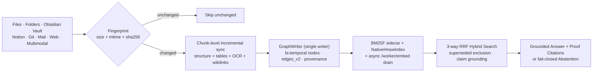

 

# Lattice AI Current Architecture

> **Status: canonical** — current-truth architecture document, kept in sync
> with the current release. Historical subsystem notes live in
> [`docs/architecture.md`](docs/architecture.md).

Current release: **13.8.0 — Living Synthesis**.

Lattice AI is a local-first Digital Brain platform built around a single-writer
Rust product host (`lattice-host`), a 20-route loopback Python AI compute worker
(`latticeai.worker_app`), a private SQLite Knowledge Graph, a model-agnostic
Adaptive Agent Harness, and a React / Vite 8 / TypeScript 7 UI.

## System Map

```mermaid
flowchart TB
  user(["User"])

  subgraph surfaces["Surfaces"]
    direction LR
    ui["React / Vite 8 / TS 7.0.2 app<br/>lazy routes · per-route i18n · ko · en"]
    desktop["Tauri 2.11 desktop shell<br/>boots the host topology"]
    editor["VS Code<br/>extension"]
    browser["Browser<br/>extension"]
    desktop ~~~ ui ~~~ editor ~~~ browser
  end

  subgraph host["Lattice Host — the product server (Rust, 127.0.0.1)"]
    direction TB
    door["One Door: 422 native operations · 41 route families<br/>anything not native and not on the 20-route allowlist ⇒ 404"]
    subgraph crates["Nine Workspace Crates"]
      direction TB
      plat["lattice-platform (317 ops · 7 domains)<br/>workspaceos · toolsurface · governance · adminops<br/>knowledge · modelops · shell"]
      retr["lattice-retrieval (65 ops)<br/>BM25F sidecar · NativeHnswIndex · 3-way RRF<br/>grounding · chronicle as_of · self_model"]
      ingestc["lattice-ingest (28 ops)<br/>incremental chunk sync · debounced watch<br/>native Obsidian wikilinks · Notion/Git/Mail interop"]
      chatc["lattice-chat (8 ops)<br/>chat · history · native ingest_generated"]
      jobsc["lattice-jobs (4 ops)<br/>index · adaptive drain scheduler"]
      authc["lattice-auth<br/>password login · sessions · CSRF"]
      agentc["lattice-agent (6 groups)<br/>kernel · parse · content · tools · surface · prompts<br/>Adaptive Harness · DurableWorkflowStore"]
      corec["lattice-core<br/>Store (generation epoch) · GraphWriter (single writer)<br/>temporal · entity_resolution · embedding_contract"]
      hostc["lattice-host<br/>gateway · supervisor · static UI"]
    end
    supervisor["Supervisor<br/>uvicorn worker spawn · /health gate · backoff restart"]
    door --> crates
    door --> supervisor
  end

  subgraph gates["Trust Boundary — enforced in Rust"]
    direction LR
    trust["auth · consent · audit · redaction"]
    mode["PermissionMode<br/>strict · trusted · bypass"]
    net["NetworkBoundary<br/>local_only · cloud_allowed"]
    breakers["Circuit breakers<br/>mode-invariant"]
    trust ~~~ mode ~~~ net ~~~ breakers
  end

  subgraph worker["Python AI Worker — compute only (latticeai.worker_app · 20 routes)"]
    direction LR
    llm["Inference<br/>/agent/llm · /worker/llm/stream<br/>oMLX · MLX · Ollama · llama.cpp · LM Studio · vLLM"]
    compute["Compute seams<br/>/worker/{embed,extract,parse,asr,<br/>render/docx|pdf|pptx|xlsx,vector/query}"]
    catalog["Model & Engine Catalog<br/>/models · /engines/* · /worker/sysinfo · /health"]
    llm ~~~ compute ~~~ catalog
  end

  subgraph data["Brain — Single-Writer SQLite"]
    direction LR
    kg["Knowledge Graph<br/>bi-temporal nodes · edges_v2 · provenance"]
    store["SQLite WAL<br/>live restore via generation epoch"]
    archive["Portable Archives<br/>.latticebrain (AEAD + X25519/Ed25519)"]
    kg ~~~ store ~~~ archive
  end

  cloud["Cloud LLM Lane — opt-in, off by default<br/>api_key live probe · cli_oauth (agy / grok)<br/>ReviewSink + shape-only EgressAudit"]

  user --> surfaces
  surfaces --> host
  door -- "20 allow-listed routes only" --> gates
  gates --> worker
  corec -- "single writer (Rust)" --> data
  crates -- "WAL reads" --> data
  chatc -- "minimal sanitized slice only" --> cloud
  cloud -- "streamed answer + kg_cloud_expansion proposal" --> chatc
  net -. "local_only blocks entirely" .-> cloud
  breakers -. "sensitive/private filtered in both modes" .-> cloud

  style cloud stroke-dasharray: 5 5
```

## Rust Workspace (9 Crates)

| Crate | Responsibility | Key Modules |
| --- | --- | --- |
| `lattice-host` | Product composition root, One Door router, static UI server, Python worker supervisor | `gateway/onedoor.rs`, `gateway/product.rs` |
| `lattice-core` | SQLite `Store` with live-restore generation epoch, single-writer `GraphWriter`, bi-temporal facts, entity resolution, `EmbeddingIndexContract`, idempotent worker seam client | `graph_write/`, `temporal.rs`, `entity_resolution.rs`, `embedding_contract.rs`, `worker.rs` |
| `lattice-auth` | Password authentication, session management, CSRF origin guard | `session.rs`, `config.rs` |
| `lattice-agent` | Safety kernel, Universal Adaptive Agent Harness (`probe.rs` 3-turn micro-probing, `ui_resolve.rs`, `rag_grounding.rs`), fail-closed verifier, `DurableWorkflowStore` | `kernel/`, `parse/`, `content/`, `tools/`, `surface/`, `prompts/` |
| `lattice-retrieval` | Pre-tokenized BM25F sidecar (`bm25_node_stats`), pure-Rust `NativeHnswIndex`, 3-way BM25F + Vector + Graph RRF hybrid search, claim-level grounding & abstention, `as_of` temporal chronicle, Self-Model | `bm25/`, `native_hnsw.rs`, `hybrid.rs`, `grounding.rs`, `chronicle_api/`, `self_model.rs` |
| `lattice-ingest` | Chunk-level incremental sync, `DebouncedWatchEngine`, PDF/table/OCR structure preservation, native Obsidian (`[[wikilink]]` `LINKS_TO` edges) and Notion/Git/Mail interop bridges through `GraphWriter` | `incremental_sync.rs`, `incremental_watch.rs`, `document_structure.rs`, `local_files_api/{folder.rs,interop.rs}` |
| `lattice-jobs` | Background embedding & vector index drain scheduler | `index.rs` |
| `lattice-platform` | 7 domain route families: `workspaceos`, `toolsurface` (native `POST /mcp`, tools, plugins, computer use), `governance` (Review Center, change proposals, hooks, workflows), `knowledge` (portability, X25519/Ed25519 selective subgraph share, network boundary, multimodal, voice), `modelops`, `adminops`, `shell` | `workspaceos/`, `toolsurface/`, `governance/`, `knowledge/`, `modelops/`, `adminops/`, `shell/` |
| `lattice-chat` | Grounded chat orchestration, history, native `ingest_generated`, opt-in cloud escalation | `chat.rs`, `history.rs` |

Crate-level ownership maps live in
[`rust/lattice-agent/ARCHITECTURE.md`](rust/lattice-agent/ARCHITECTURE.md) and
[`rust/lattice-platform/ARCHITECTURE.md`](rust/lattice-platform/ARCHITECTURE.md).

## Knowledge & Retrieval Pipeline

- **Single-writer SQLite (`GraphWriter`):** All writes serialize through
  `lattice-core::graph_write`. Restoring a `.latticebrain` archive bumps the
  store generation epoch so stale pooled connections close automatically without
  restarting the host.
- **Native Interop Bridges:** `POST /api/ingestion/obsidian` parses `.md` notes
  and creates `LINKS_TO` edges from `[[wikilink]]` references directly through
  `GraphWriter`; `POST /api/ingestion/interop` natively ingests Notion directory
  or `.zip` exports, local Git commit logs, and `.eml`/`.ics` mail/calendar
  files behind human-in-the-loop permission tokens.
- **Grounded Retrieval:** Active vs. superseded claims are separated at query
  time (`include_historical = false` by default), `as_of` enables point-in-time
  chronicle queries, and `grounding.rs` verifies citations before answering.

## Python AI Worker & Cross-Platform Model Runtime

`latticeai.worker_app` (`create_worker_app`) is a loopback-only compute worker
serving **20** allow-listed routes (`/agent/{llm,tool}`,
`/worker/{llm/stream,sysinfo,embed,extract,parse,asr,render/{docx,pdf,pptx,xlsx},vector/query}`,
`/models*`, `/engines/*`, `GET /api/embeddings/status`, `/health`) with
`worker_resilience.py` (`x-lattice-idempotency-key` coalescing and unary timeout
isolation).

- **Cross-Platform Engine Adapters (`latticeai/services/engine_adapters.py`):**
  - **macOS (Apple Silicon):** `omlx` (Homebrew or zero-Homebrew universal2
    wheel fallback in `~/.omlx/venv`) with tiered RAM/SSD KV caching and live
    available-RAM pressure tuning (`host_available_ram_gb`, `omlx_serve_args`),
    plus `local_mlx`, `ollama`, `lmstudio`, and `llamacpp`.
  - **Windows:** `winget` silent installation for `ollama`, `llamacpp`, and
    `lmstudio`, with automatic `pip install llama-cpp-python[server]` fallback.
  - **Linux:** Official Ollama installer script plus `pip` `llamacpp` / `vllm`
    adapters and quantized-KV GPU serving (`llamacpp_serve_args`).
- **Model Routing:** `Qwen3.8-27B-4bit` routes to `mlx-community/Qwen3.8-27B-4bit`
  on 32GB+ Apple Silicon Macs and automatically maps to public GGUF routes
  (`ggml-org/Qwen3.8-27B-GGUF` / `unsloth/Qwen3.8-27B-GGUF`) on Windows and
  Linux with `HF_XET_HIGH_PERFORMANCE=1` enabled by default.

## Frontend, Tooling & Verification Surface

- **Frontend (`frontend/src`):** React + Vite 8 + TypeScript 7.0.2 (`tsgo`),
  native ESM configs ([`vite.config.mts`](vite.config.mts),
  [`vitest.config.mts`](vitest.config.mts)), lazy route splitting with per-route
  i18n namespaces (`ko`, `en`), and `ErrorBoundary` isolation around every route
  and heavy panel.
- **Zero-TS5 OpenAPI Codegen:** [`scripts/generate_openapi_types.mjs`](scripts/generate_openapi_types.mjs)
  deterministically generates `frontend/src/api/openapi.ts` (415 paths / 457
  operations) from `frontend/openapi.json` with zero TypeScript 5 dependencies.
- **Automated Quality Gates:**
  - Frontend: `npm run test:frontend:coverage` (100% statements, branches,
    functions, lines across all 111 test files), `npm run typecheck` (`tsc 7.0.2`),
    `npm run check:bundle` (`<= 150 KiB` initial JS gzip), i18n literal &
    namespace checks.
  - Python: `npm run test:coverage` (`>= 90%` floor, currently `96%+`), `ruff`,
    `mypy`, domain-modularized unit tests under `tests/unit/`.
  - Rust & Desktop: `cargo fmt --check`, `cargo clippy --workspace --all-targets -- -D warnings`,
    parallel `cargo-nextest`, `src-tauri` `cargo check`.
  - Documentation & Visual: `docs:check-current`, `docs:check-links`,
    `docs:check-languages` (100% EN ↔ KO parity), `check:max-file-lines`,
    Playwright visual smoke & release evidence binding.

## Local-First Boundary, Governance & Portability

- **Proposal-First Governance:** Additive creates run with minimal friction;
  mutations and deletions of existing user content stage as review proposals in
  Review Center and apply only on explicit approval.
- **Network Boundary:** Defaults to `local_only`. Opt-in `cloud_allowed` strips
  `sensitive` / `private` / `do_not_share` nodes in both modes, enforces
  per-turn/per-session token budgets, logs shape-only egress audits, and stages
  cloud extractions as `kg_cloud_expansion` proposals.
- **Portability & Selective Brain Network:** Full Brain backups use
  AEAD-encrypted `.latticebrain` archives (v2 KDF). Selective subgraph sharing
  is opt-in (`LATTICEAI_BRAIN_NETWORK=1`) using X25519 sealed-box encryption and
  Ed25519 provenance signatures, landing as review proposals on the recipient.

## Release Artifact Map

13.8.0 exact artifact names:

- Python wheel: `dist/ltcai-13.8.0-py3-none-any.whl`
- Python sdist: `dist/ltcai-13.8.0.tar.gz`
- npm tarball: `ltcai-13.8.0.tgz`
- VS Code / Cursor / Antigravity extension: `dist/ltcai-13.8.0.vsix`
- macOS Apple Silicon DMG: `src-tauri/target/release/bundle/dmg/Lattice AI_13.8.0_aarch64.dmg`

## Known Boundaries

- **PostgreSQL backend:** Export/status surfaces remain honestly marked
  `planned`; SQLite WAL is the canonical single-writer store.
- **Live mailbox / system calendar connectors:** Deliberately out of scope; the
  `mail` interop bridge ingests local `.eml` and `.ics` files only.
- **Open roadmap items:** Tracked in [`docs/ROADMAP.md`](docs/ROADMAP.md) and
  [`FEATURE_STATUS.md`](FEATURE_STATUS.md).
