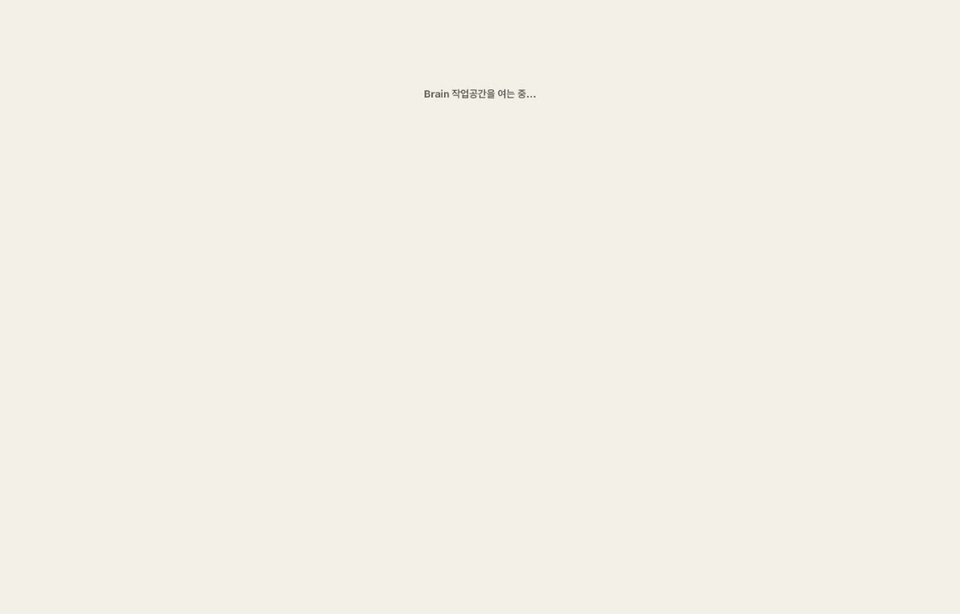
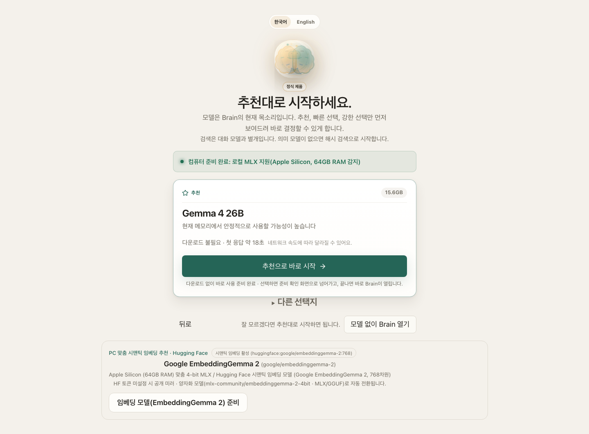
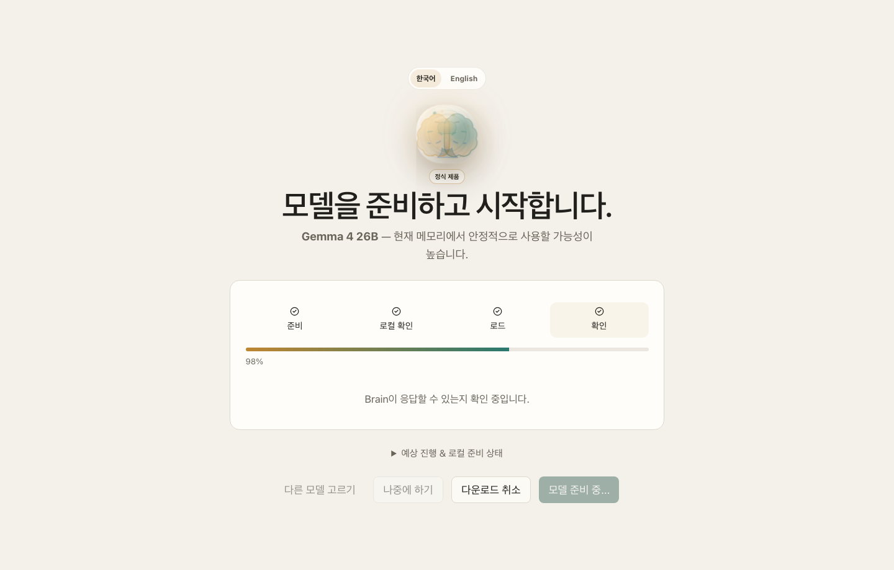
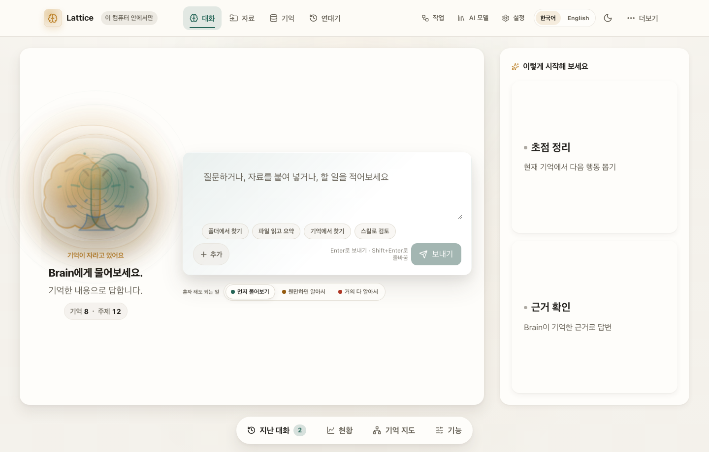
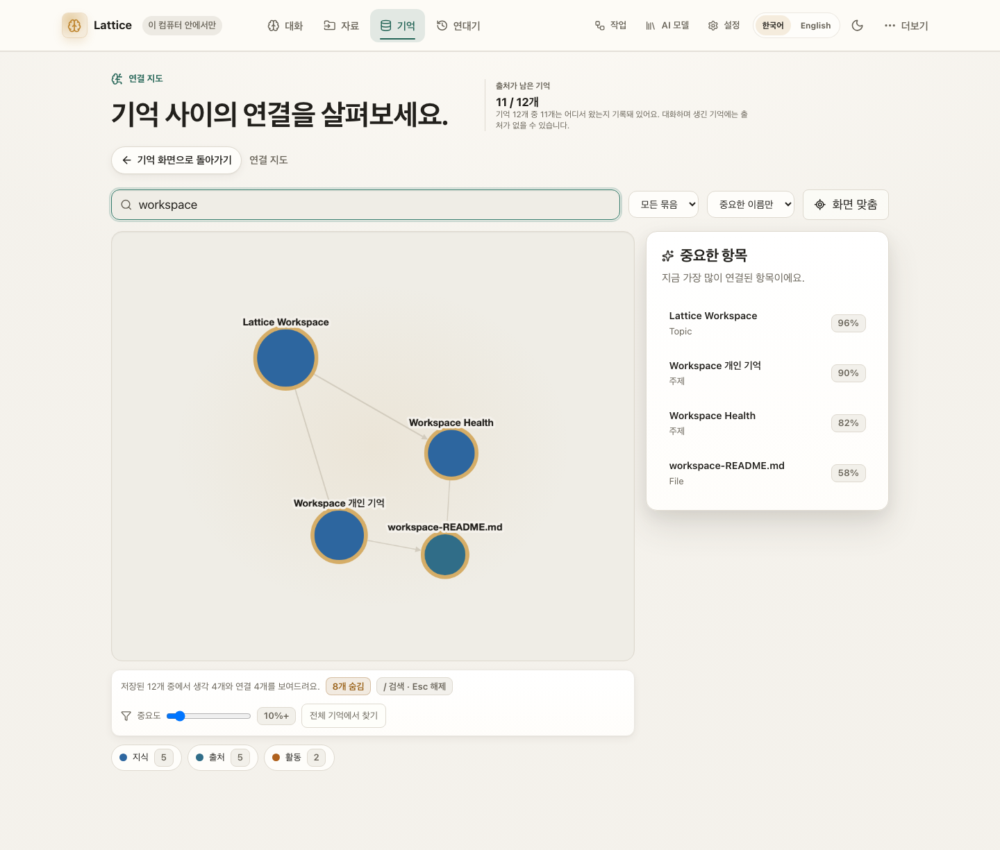
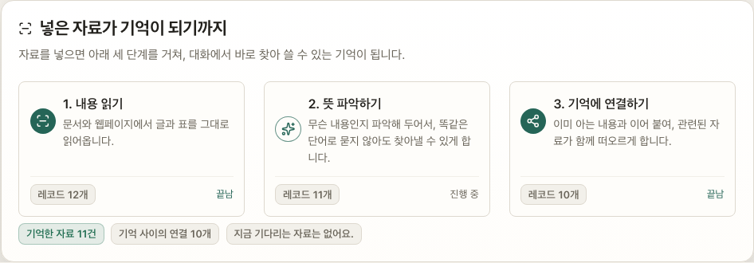
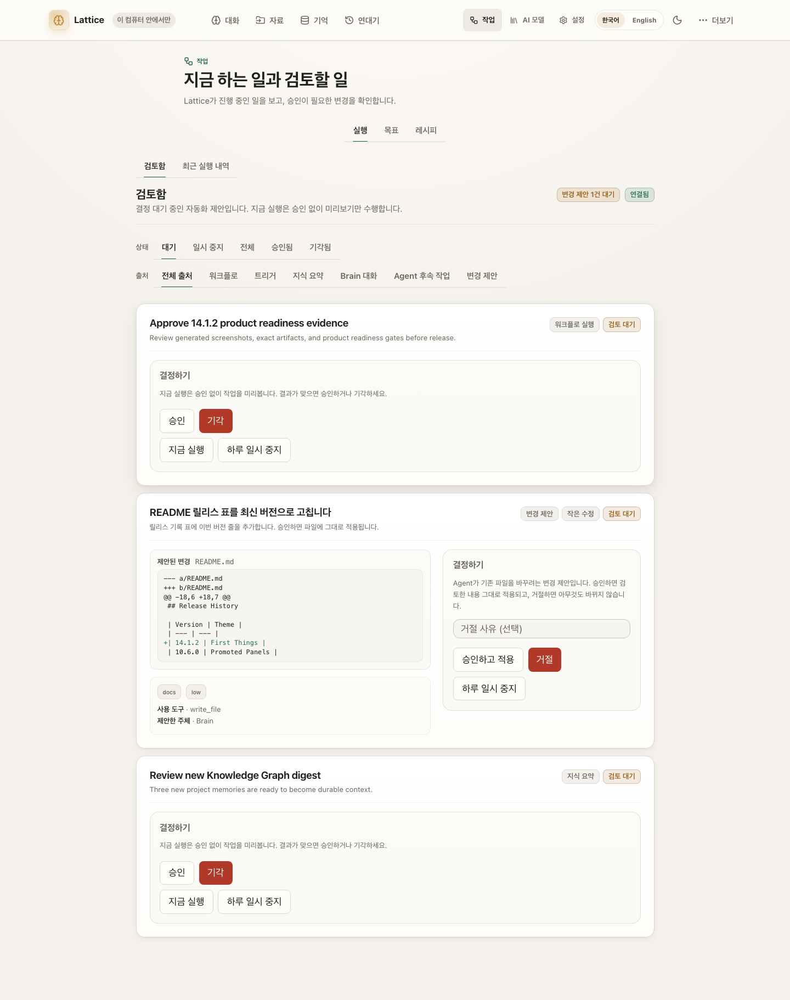
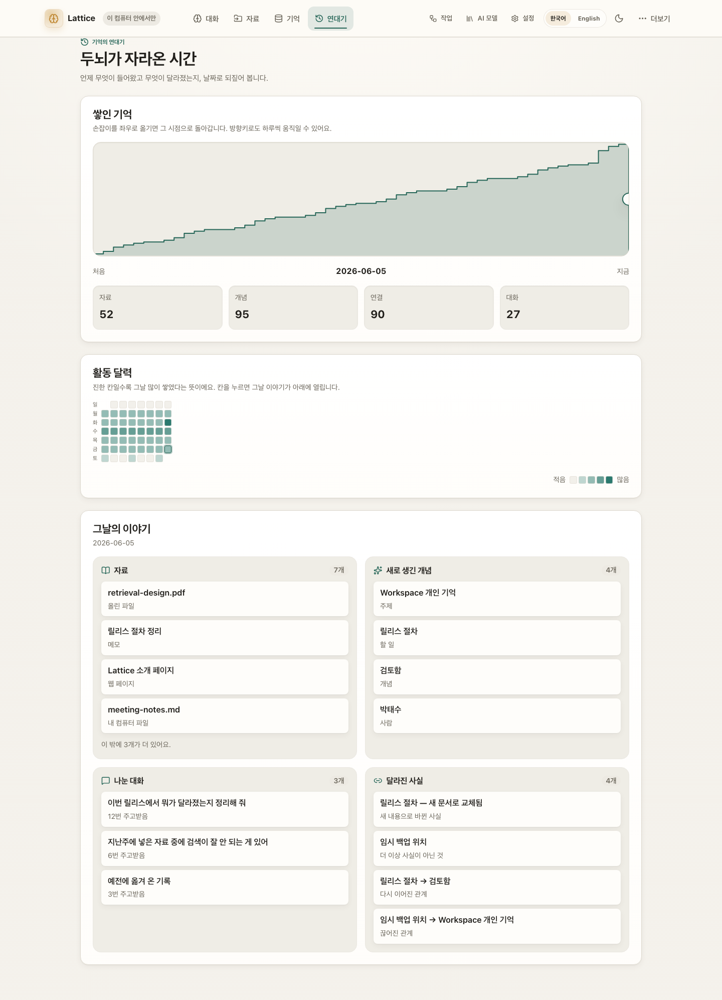
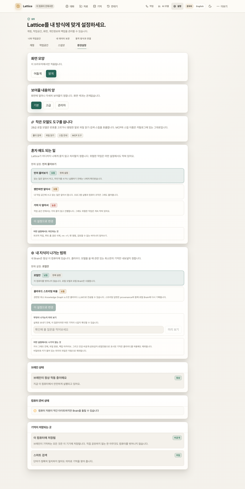

<div align="center">

[](README.md) [](README.ko.md)

# Lattice AI

**모델은 오늘 쓰는 목소리이고, 브레인은 평생 남는 나의 자산입니다.**

[](https://pypi.org/project/ltcai/)
[](https://www.npmjs.com/package/ltcai)
[](https://marketplace.visualstudio.com/items?itemName=parktaesoo.ltcai)
[](https://open-vsx.org/extension/parktaesoo/ltcai)
[](https://github.com/TaeSooPark-PTS/LatticeAI/actions/workflows/ci.yml)
[](https://github.com/TaeSooPark-PTS/LatticeAI/actions/workflows/publish.yml)
[](LICENSE)

<br/>



</div>

Lattice AI는 대화, 파일, 폴더, 노트, 웹 캡처를 내가 소유하는 단일 프라이빗 지식 그래프로 통합하는 **로컬 우선 디지털 브레인**입니다. 기본값은 100% 로컬 추론이며, 클라우드 모델 연결은 선택 사항입니다. 사용자의 명시적 동의 없이는 어떤 데이터도 기기 밖으로 전송되지 않습니다.

---

## 왜 Lattice AI인가요?

- **로컬 우선 디지털 브레인 & 하드웨어 자동 맞춤** — 모든 기억, 출처 이력, 그래프 관계는 로컬 SQLite와 이식 가능한 암호화 `.latticebrain` 아카이브에 저장됩니다. 초기 설치 직후 오프라인에서도 결정론적 `lattice-local-hash-v1` 임베딩으로 즉시 동작하며, 기기 사양에 맞는 로컬 **EmbeddingGemma 2**(`768d`) 또는 시맨틱 프로바이더(`mlx-community`, `ggml-org` GGUF, `onnx-community`)로 **실시간 SSE 다운로드 진행률(`MB/s`, `ETA`)**과 함께 매끄럽게 업그레이드할 수 있습니다.
- **하이브리드 GraphRAG (BM25F + 벡터 + 2-Hop 지식 그래프 RRF)** — 한국어 조사 제거·CJK 바이그램·식별자 서브워드를 지원하는 필드 가중 Okapi BM25F, 밀집/서브워드 벡터 검색, 1-Hop/2-Hop 지식 그래프 구조 확장(`RELATES_TO`, `MENTIONS`, `PART_OF`, `[[위키링크]]`, `#태그`)을 Reciprocal Rank Fusion(RRF)으로 결합합니다.
- **제안 우선 안전 자율성 & 검토 센터** — 새 파일 생성 같은 추가 작업은 최소 마찰로 실행되고, 기존 사용자 파일 수정·삭제나 클라우드 추출 기억은 해시 검증된 **검토 센터** 제안으로 스테이징되어 전후 비교(diff) 승인 후에만 반영됩니다. 2B급 소형 로컬 모델도 가이드 프롬프트로 안전하게 동작하며, LLM이 로드되지 않은 상태의 워크플로우/에이전트 시뮬레이션은 모델을 호출하지 않는 **결정론적 LLM-free 동작**임을 명시합니다.
- **모든 화면에서 하나의 브레인** — **macOS 데스크톱 앱(`.dmg`)**, **웹 스튜디오(`/app`)**, **VS Code / Cursor / Open VSX 확장**, **브라우저 확장**, **`LTCAI` CLI**가 모두 동일한 로컬 브레인을 공유합니다.

---

## 범용 적응형 에이전트 하네스 벤치마크 (v13.4.0)

LatticeAI 13.4.0은 **범용 적응형 에이전트 하네스(Universal Adaptive Agent Harness)**(`rust/lattice-agent/src/kernel/`)를 도입합니다. 이 하네스는 모델별 하드코딩 분기(**Zero per-model code branches**) 없이도 소형 로컬 인스트럭션 튜닝 모델(0.5B ~ 7B 파라미터)이 도구 체인, 웹 탐색, 컴퓨터 유즈, 양방향 시간 축 RAG 그라운딩에서 프론티어 급의 안정성을 발휘하도록 지원합니다.

`Qwen2.5-0.5B-Instruct-Q4_K_M`을 대상으로 25개 실환경 벤치마크 태스크에 걸쳐 실측한 결과:

| 역량 카테고리 | Raw Baseline (하네스 미적용) | Standard Loop (v13.3) | 적응형 하네스 (v13.4.0) | 절대 개선폭 |
| :--- | :---: | :---: | :---: | :---: |
| **도구 호출 (Tool Calling)** | 20.0% (1/5) | 0.0% (0/5) | **80.0%** (4/5) | **+60.0 pp** |
| **웹 탐색 (Web Handling)** | 0.0% (0/5) | 80.0% (4/5) | **80.0%** (4/5) | **+80.0 pp** |
| **컴퓨터 유즈 (Computer Use)** | 0.0% (0/5) | 0.0% (0/5) | **100.0%** (5/5) | **+100.0 pp** |
| **답변 품질 (Answer Quality)** | 60.0% (3/5) | 20.0% (1/5) | **60.0%** (3/5) | **0.0 pp** (std 대비 +40 pp) |
| **RAG 그라운딩 (RAG Grounding)** | 60.0% (3/5) | 20.0% (1/5) | **100.0%** (5/5) | **+40.0 pp** (std 대비 +80 pp) |
| **전체 작업 통과율** | **28.0%** (7/25) | **24.0%** (6/25) | **84.0%** (21/25) | **+56.0 pp (상대 개선율 +200.0%)** |

실측 벤치마크 상세 보고서 및 재현 방법은 [docs/ko/ADAPTIVE_HARNESS_BENCHMARK.md](docs/ko/ADAPTIVE_HARNESS_BENCHMARK.md) (또는 [영문 정본](docs/ADAPTIVE_HARNESS_BENCHMARK.md))에서 확인할 수 있습니다.

---

## 빠른 시작

### 1. 데스크톱 앱 (macOS)

[GitHub Releases](https://github.com/TaeSooPark-PTS/LatticeAI/releases)에서 `Lattice AI_14.1.2_aarch64.dmg`를 내려받아 실행하세요.

### 2. 한 줄 명령 CLI & 웹 스튜디오

```bash
pip install ltcai          # 또는: npm install -g ltcai
LTCAI                      # http://127.0.0.1:4825/app 웹 스튜디오 실행
```

- **Apple Silicon 로컬 모델 (MLX)**: `pip install "ltcai[local]"`
- **포인터 자동화 도구 (선택)**: `pip install "ltcai[pointer]"`

### 3. 에디터 확장 (VS Code · Cursor · Antigravity)

[VS Code Marketplace](https://marketplace.visualstudio.com/items?itemName=parktaesoo.ltcai) 또는 [Open VSX](https://open-vsx.org/extension/parktaesoo/ltcai)에서 `parktaesoo.ltcai`를 설치하면 에디터 안에서 바로 파일 동기화, 브레인 기반 질의, 변경 제안 검토를 수행할 수 있습니다.

### 처음 5분 흐름

1. **브레인 깨우기** — 로컬 소유자 프로필을 확인합니다.
2. **추천 로컬 모델 및 임베더 선택** — 내 하드웨어에 맞는 모델을 실시간 SSE 진행률과 함께 설치합니다.
3. **자료 담기** — 폴더, 문서, 노트, 웹페이지를 추가합니다.
4. **내 말로 질문하기** — 근거 출처, 지식 그래프 연결, 검토 센터 diff를 직접 확인합니다.

---

## 제품 둘러보기

| 온보딩 & 하드웨어 맞춤 추천 | 실시간 모델 라이브러리 & SSE 진행률 |
| --- | --- |
|  |  |
| **브레인 채팅 홈** — 출처 근거가 함께 제시되는 답변 | **기억 그래프** — 2-Hop 개념 및 파일 연결 탐색 |
|  |  |
| **자료 수집 & 지식 여정** — 자료가 기억으로 정리되는 과정 | **검토 센터** — 모든 수정이 반영되기 전 diff 확인 |
|  |  |
| **브레인 연대기** — 성장 곡선, 히트맵, 일일 기록 | **자율성 다이얼 & 시스템** — 쉬운 언어로 제어하는 권한 |
|  |  |

전체 화면 인덱스: [output/release/v14.1.2/SCREENSHOT_INDEX.md](output/release/v14.1.2/SCREENSHOT_INDEX.md) (로그인 및 라이브러리 화면: [01-login.png](output/release/v14.1.2/screenshots/01-login.png), [06-capture.png](output/release/v14.1.2/screenshots/06-capture.png), [07-model-library.png](output/release/v14.1.2/screenshots/07-model-library.png)).

---

## 한국어 문서 & 아키텍처 허브

| 영역 | 문서 | 주요 내용 |
| --- | --- | --- |
| **시작 가이드** | [docs/ko/ONBOARDING.md](docs/ko/ONBOARDING.md) | 처음 5분 제품 흐름 및 첫 실행 보장 |
| **제품 철학** | [docs/ko/WHY_LATTICE.md](docs/ko/WHY_LATTICE.md) | 개별 AI 모델보다 브레인이 오래 남아야 하는 이유 |
| **시스템 아키텍처** | [docs/ko/ARCHITECTURE.md](docs/ko/ARCHITECTURE.md) | `lattice-host` Rust 서버, 단일 `GraphWriter`, 20개 라우트 Python AI 워커 |
| **기능 현황** | [docs/ko/FEATURE_STATUS.md](docs/ko/FEATURE_STATUS.md) | 현재 출시된 기능과 정직한 시스템 한계 |
| **적응형 하네스 벤치마크** | [docs/ko/ADAPTIVE_HARNESS_BENCHMARK.md](docs/ko/ADAPTIVE_HARNESS_BENCHMARK.md) | 25개 태스크 실측 보고서 (`Qwen2.5-0.5B-Instruct-Q4_K_M` `28.0% → 84.0%`) |
| **운영 & 셀프 호스팅** | [docs/ko/OPERATIONS.md](docs/ko/OPERATIONS.md) | 저장소 구조, `.latticebrain` 백업/복원, 공개 모드 체크리스트 |
| **엔터프라이즈 & 오픈 코어** | [docs/ko/ENTERPRISE.md](docs/ko/ENTERPRISE.md) | 오픈 코어 경계 및 [EDITION_STRATEGY.md](docs/ko/EDITION_STRATEGY.md) |
| **보안 & 프라이버시** | [docs/ko/SECURITY.md](docs/ko/SECURITY.md) · [docs/ko/PRIVACY.md](docs/ko/PRIVACY.md) | 위협 모델, 루프백 기본값, 외부 전송 감사, [TRUST_MODEL.md](docs/ko/TRUST_MODEL.md) |
| **기여자 가이드** | [docs/ko/DEVELOPMENT.md](docs/ko/DEVELOPMENT.md) · [docs/ko/CONTRIBUTING.md](docs/ko/CONTRIBUTING.md) | 로컬 빌드, Rust 크레이트 구조, 품질 게이트, [ROADMAP.md](docs/ko/ROADMAP.md) |
| **CI / CD & 릴리스 게이트** | [docs/ko/CI_AND_RELEASE_GATES.md](docs/ko/CI_AND_RELEASE_GATES.md) | CI 통과 강제, 자동 릴리스/CD 체이닝, 병렬 테스트 구조 |
| **릴리스 & 변경 이력** | [docs/ko/RELEASE.md](docs/ko/RELEASE.md) · [docs/ko/CHANGELOG.md](docs/ko/CHANGELOG.md) | 릴리스 절차, [RELEASE_NOTES.md](docs/ko/RELEASE_NOTES.md), 버전별 릴리스 노트 ([`docs/ko/releases/`](docs/ko/releases/README.md)) |

---

## 현재 릴리스

현재 최신 릴리스는 **14.1.2 — Living Synthesis**입니다:

- **전 소스 언어 무주석 & 무억제 코드베이스** — Python, TypeScript/JavaScript, Rust, Shell, CSS, HTML 소스 파일에서 기계 필수 지시문(`#!/usr/bin/env ...`, `/// <reference ... />`)을 제외한 모든 주석, 독스트링, JSDoc, 억제 지시문을 제거하고 전역 설정 완화 없이 소스 코드 자체를 수정해 모든 Ruff, mypy, TypeScript, Clippy 검증을 통과했습니다.
- **영구 무주석 CI 게이트 (`scripts/check_no_comments.mjs`)** — `npm run lint`와 `.github/workflows/ci.yml`에 `npm run check:no-comments`를 연동해 향후 주석·독스트링·억제 지시문 유입을 차단하며 `AGENTS.md`, `CONTRIBUTING.md` 및 한국어 미러 문서에 영구 정책을 명시했습니다.
- **v14.1.2 기반 위에 구축** — 저장소 전역 `ruff format .` 일관성, 예외 0건 전역 `C901` (`max-complexity = 20`), fail-closed `0 unclaimed` 서버 i18n 래칫, Rust ↔ Python UTC 타임스탬프 통일, TypeScript 7 `noUncheckedIndexedAccess` (Vitest 100%)를 유지합니다.

<details>
<summary>14.1.2 릴리스 노트 및 정확한 배포 아티팩트 목록</summary>

릴리스 가이드: [docs/ko/RELEASE.md](docs/ko/RELEASE.md) · 변경 이력: [docs/ko/CHANGELOG.md](docs/ko/CHANGELOG.md) · 상세 릴리스 노트: [docs/ko/releases/RELEASE_NOTES_v14.1.2.md](docs/ko/releases/RELEASE_NOTES_v14.1.2.md).

14.1.2 배포 아티팩트는 반드시 정확한 파일명만 사용합니다:

- `dist/ltcai-14.1.2-py3-none-any.whl`
- `dist/ltcai-14.1.2.tar.gz`
- `ltcai-14.1.2.tgz`
- `dist/ltcai-14.1.2.vsix`
- `src-tauri/target/release/bundle/dmg/Lattice AI_14.1.2_aarch64.dmg`

와일드카드(`dist/*`) 업로드는 금지됩니다. 패키지 레지스트리 배포는 `CI` 통과 후 `.github/workflows/release.yml` → `.github/workflows/publish.yml`(CD) 파이프라인을 통해 자동 검증·실행됩니다.

</details>

---

## 정직한 경계

- **기본값은 로컬**: SQLite가 실제 운영 브레인 저장소입니다. 클라우드 모델(`cli_oauth` 또는 `api_key`), 모델 다운로드, 브레인 네트워크, 업데이트 확인은 모두 사용자의 명시적 행동이 있어야만 동작합니다.
- **정직한 검색 & 시뮬레이션**: 로드된 LLM이 없을 때 에이전트/워크플로우 시뮬레이션은 모델을 호출하지 않는 결정론적 동작이며 화면에 명시됩니다. 벡터 검색 기본값은 정확 전수 검색이며 `LATTICEAI_VECTOR_INDEX=hnsw` 설정 시 512개 이상 벡터에서 `hnsw+rescore`를 활성화합니다.
- **안전한 삭제 & 코드 서명**: 감시 폴더 정리는 확인 후 지식 그래프에서만 제거하며 디스크 원본 파일은 삭제하지 않습니다. macOS `.dmg`는 ad-hoc 서명되므로 첫 실행 시 macOS Gatekeeper 허용 절차가 필요합니다. 남은 개선 항목은 [docs/ko/ROADMAP.md](docs/ko/ROADMAP.md) 및 [docs/ko/FEATURE_STATUS.md](docs/ko/FEATURE_STATUS.md)에 투명하게 기록합니다.

---

## 릴리스 히스토리

이 저장소의 공개 릴리스 히스토리는 `v13.0.0+`(Rust 호스트 + 도메인 그룹 아키텍처)부터 유지됩니다. 한국어 요약은 [docs/ko/RELEASE_NOTES.md](docs/ko/RELEASE_NOTES.md), 버전별 상세 노트는 [docs/ko/releases/](docs/ko/releases/README.md)에서 확인할 수 있습니다.

| 버전 | 테마 | 릴리스 노트 |
| --- | --- | --- |
| 14.1.2 | Living Synthesis | [RELEASE_NOTES_v14.1.2.md](docs/ko/releases/RELEASE_NOTES_v14.1.2.md) |
| 14.1.1 | Living Synthesis | [RELEASE_NOTES_v14.1.1.md](docs/ko/releases/RELEASE_NOTES_v14.1.1.md) |
| 14.1.0 | Living Synthesis | [RELEASE_NOTES_v14.1.0.md](docs/ko/releases/RELEASE_NOTES_v14.1.0.md) |
| 14.0.0 | Living Synthesis | [RELEASE_NOTES_v14.0.0.md](docs/ko/releases/RELEASE_NOTES_v14.0.0.md) |
| 13.9.0 | Living Synthesis | [RELEASE_NOTES_v13.9.0.md](docs/ko/releases/RELEASE_NOTES_v13.9.0.md) |
| 13.8.0 | Living Synthesis | [RELEASE_NOTES_v13.8.0.md](docs/ko/releases/RELEASE_NOTES_v13.8.0.md) |
| 13.7.2 | Living Synthesis | [RELEASE_NOTES_v13.7.2.md](docs/ko/releases/RELEASE_NOTES_v13.7.2.md) |
| 13.7.1 | Living Synthesis | [RELEASE_NOTES_v13.7.1.md](docs/ko/releases/RELEASE_NOTES_v13.7.1.md) |
| 13.7.0 | Living Synthesis | [RELEASE_NOTES_v13.7.0.md](docs/ko/releases/RELEASE_NOTES_v13.7.0.md) |
| 13.6.0 | Living Synthesis | [RELEASE_NOTES_v13.6.0.md](docs/ko/releases/RELEASE_NOTES_v13.6.0.md) |
| 13.5.0 | Living Synthesis | [RELEASE_NOTES_v13.5.0.md](docs/ko/releases/RELEASE_NOTES_v13.5.0.md) |
| 13.4.2 | Living Synthesis | [RELEASE_NOTES_v13.4.2.md](docs/ko/releases/RELEASE_NOTES_v13.4.2.md) |
| 13.4.1 | Living Synthesis | [RELEASE_NOTES_v13.4.1.md](docs/ko/releases/RELEASE_NOTES_v13.4.1.md) |
| 13.4.0 | Living Synthesis | [RELEASE_NOTES_v13.4.0.md](docs/ko/releases/RELEASE_NOTES_v13.4.0.md) |
| 13.3.1 | Living Synthesis | [RELEASE_NOTES_v13.3.1.md](docs/ko/releases/RELEASE_NOTES_v13.3.1.md) |
| 13.3.0 | Living Synthesis | [RELEASE_NOTES_v13.3.0.md](docs/ko/releases/RELEASE_NOTES_v13.3.0.md) |
| 13.2.1 | Living Synthesis | [RELEASE_NOTES_v13.2.1.md](docs/ko/releases/RELEASE_NOTES_v13.2.1.md) |
| 13.2.0 | Living Synthesis | [RELEASE_NOTES_v13.2.0.md](docs/ko/releases/RELEASE_NOTES_v13.2.0.md) |
| 13.1.0 | Living Synthesis | [RELEASE_NOTES_v13.1.0.md](docs/ko/releases/RELEASE_NOTES_v13.1.0.md) |
| 13.0.0 | Sovereign Synthesis | [RELEASE_NOTES_v13.0.0.md](docs/ko/releases/RELEASE_NOTES_v13.0.0.md) |
