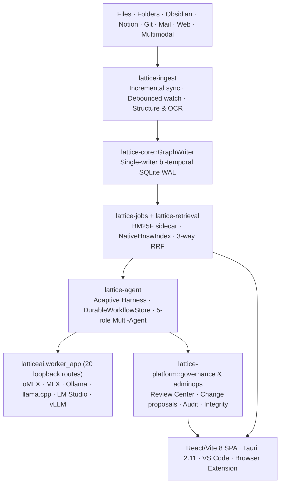

 

# Lattice AI Subsystem & Design Overview

> **Status: canonical** — companion subsystem and design-principle overview for
> the current release. The full system map, crate inventory, and exact release
> artifact map live in [`ARCHITECTURE.md`](../ARCHITECTURE.md).

Current release: **14.0.0 — Living Synthesis**.

Lattice AI is a local-first **Digital Brain Platform**. The architecture is
organized around one durable center owned by the user: the single-writer SQLite
**Knowledge Graph** (`lattice-core::graph_write`). Models, inference engines,
tools, agents, retrieval indexes, workflows, and UI surfaces are replaceable
layers operating over verified graph context. Models are replaceable; knowledge
is durable.

## Core Design Principles

- **Local-first by default:** User knowledge, sessions, vectors, and audit logs
  stay on the local machine under `local_only` network posture unless cloud
  escalation is explicitly enabled.
- **Single-writer durability:** All Knowledge Graph mutations serialize through
  `lattice-core::graph_write::GraphWriter` and `Store::write_conn` in Rust;
  restoring a `.latticebrain` archive advances the store generation epoch so
  pooled connections recycle cleanly without restarting `lattice-host`.
- **Rust owns trust & control; Python owns AI compute:** `lattice-host`
  enforces authentication (`$scrypt$` + sessions + bounded rate limits + CSRF),
  workspace isolation, proposal-first governance, TOCTOU-safe workspace I/O
  (`safe_io`), and allow-listed egress; `latticeai.worker_app` exposes only 20
  loopback compute routes for inference, embeddings, parsing, OCR/ASR, and
  document rendering.
- **Model-agnostic adaptive execution:** The agent harness (`lattice-agent`)
  measures model capability via runtime micro-probing (`probe.rs`) rather than
  branching on model names, keeping `standard`, `compact`, and `guided` dials
  behind the same fail-closed permission and verification gates.
- **Transparent capability & disclosure:** Model catalog entries carry source
  origin (`Origin Country -> Vendor -> Execution`), internet requirements, and
  quantization/RAM facts as first-class fields.
- **Consistent modes with explicit admin authority:** Basic and Advanced modes
  share full workspace capabilities, while Admin mode adds explicit user,
  organization, security policy, and audit governance.

## End-to-End Workspace Flow

## Durable Core & Multimodal Ingestion

The Knowledge Graph (`docs/kg-schema.md`) stores durable personal and
organization workspace context with bi-temporal validity (`valid_from`,
`valid_until`, `superseded_by`) and provenance:

- documents (PDF, Word, Excel, PowerPoint, Markdown, HTML, code) with table,
  page, and OCR structure preservation
- images, screenshots, audio, and video metadata (`Modality::Video`)
- conversations, notes, Obsidian `[[wikilink]]` `LINKS_TO` graphs, and
  Notion / Git / `.eml` / `.ics` interop imports
- user decisions, knowledge corrections, entity aliases, generated artifacts,
  and durable workflow / agent provenance edges (`USED_BY_AGENT`,
  `GENERATED_BY`)

## Local Model Runtime & Recommendation Policy

Hardware-aware model recommendations (`latticeai/services/model_catalog.py`,
`latticeai/services/model_recommendation.py`, `latticeai/services/engine_adapters.py`)
match the local machine's OS, GPU/unified memory, and live available RAM:

- **macOS (Apple Silicon):** `omlx` (tiered RAM/SSD KV cache with live memory
  pressure tuning) and `local_mlx` (platform-guarded for `darwin`/`arm64`),
  plus `ollama`, `lmstudio`, and `llamacpp`.
- **Windows:** `winget`-assisted `ollama`, `llamacpp`, and `lmstudio`, with
  automatic `pip install llama-cpp-python[server]` fallback.
- **Linux:** Official Ollama installer plus `llamacpp` and `vllm` serving
  adapters with quantized-KV GPU flags.

Every catalog entry exposes first-class disclosure fields (`source_country`,
`source_company`, `execution_method`, `internet_requirement`, `model_name`).
For the full policy and supported families (including Qwen3.8, Gemma 4, and
EmbeddingGemma 2), see [`MODEL_POLICY.md`](../MODEL_POLICY.md).

## Canonical Subsystem Map

| Layer | Canonical Path | Responsibility |
| --- | --- | --- |
| Product Host | `rust/lattice-host/src/gateway/`, `supervisor/` | One Door 422-op router, fail-closed worker proxy, static UI serving, worker process supervisor |
| Core & Storage | `rust/lattice-core/src/{db.rs,graph_write/,integrity/,temporal.rs,entity_resolution.rs,embedding_registry.rs}` | Single-writer SQLite WAL store, generation-epoch live restore, integrity repair, bi-temporal facts, entity resolution, shadow embedding registry |
| Auth & Security | `rust/lattice-auth/src/{password.rs,ratelimit.rs,session.rs,csrf.rs}` | Versioned `$scrypt$` hashing, bounded rate limiting (`429` + `Retry-After`), sessions, CSRF guard |
| Retrieval & Brain API | `rust/lattice-retrieval/src/{bm25/,native_hnsw.rs,hybrid.rs,grounding.rs,brain_api/,chronicle_api/}` | Pre-tokenized BM25F, bounded pure-Rust HNSW, 3-way RRF, claim grounding/abstention, Brain Governance endpoints |
| Ingestion | `rust/lattice-ingest/src/{incremental_sync.rs,incremental_watch.rs,document_structure.rs,local_files_api/}` | Chunk incremental sync, debounced OS watch, `spawn_blocking` local files API, native Obsidian/Notion/Git/Mail bridges |
| Agent Harness | `rust/lattice-agent/src/{kernel/,parse/,content/,tools/,surface/,prompts/}` | Universal Adaptive Harness, fail-closed verifier, durable DAG workflows, 5-role multi-agent session, TOCTOU-safe `safe_io` |
| Platform Surface | `rust/lattice-platform/src/{workspaceos/,toolsurface/,governance/,knowledge/,modelops/,adminops/,shell/}` | Workspace OS, native MCP & tools, Review Center & proposals, `.latticebrain` portability & Brain Network, setup/catalog, admin audit |
| Chat & Jobs | `rust/lattice-chat/src/`, `rust/lattice-jobs/src/` | Grounded chat, non-blocking document sessions, bounded cloud budget, background embedding/index drain |
| Python Compute Worker | `latticeai/worker_app.py`, `latticeai/api/worker_seams.py`, `latticeai/services/{engine_adapters.py,model_runtime/}`, `lattice_brain/` | 20-route loopback inference, embeddings, parsing, document rendering, and cross-platform engine lifecycle |
| Frontend & Extensions | `frontend/src/`, `src-tauri/src/`, `vscode-extension/`, `browser-extension/` | Strict TypeScript 7 / React / Vite 8 SPA, Tauri 2.11 desktop shell, VS Code extension, browser capture extension |

## Compatibility & Upgrades

14.0.0 preserves non-destructive, read-compatible upgrades across SQLite
Knowledge Graph schemas, `.latticebrain` archives (v2 KDF), and legacy
`salt:key` password hashes (automatically verified alongside versioned
`$scrypt$` hashes). Existing workspace data is preserved without destructive
migrations.
