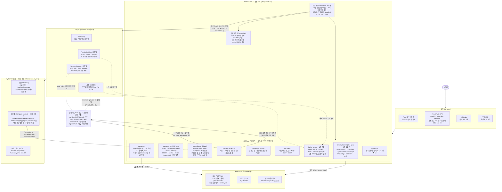
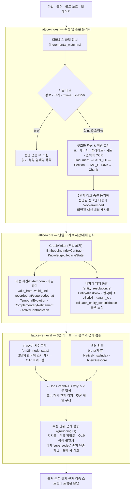

 

# Lattice AI 현재 아키텍처

> **상태: 표준 문서(Canonical)** — 현재 릴리스와 동기화되는 기준 아키텍처 문서입니다.
> 이전 하위 시스템의 상세 기록은 [`docs/ko/architecture-overview.md`](./architecture-overview.md)(영문 원본: [`docs/architecture.md`](../architecture.md))에서 확인할 수 있습니다.

현재 릴리스: **13.4.0 — Living Synthesis**.

Lattice AI는 로컬 우선(Local-first) 디지털 브레인(Digital Brain) 플랫폼입니다.
현재 아키텍처는 프라이빗 브레인, 교체 가능한 모델 런타임, 명시적 도구 레지스트리,
단일 쓰기(Single-writer) Rust 제품 서버, 그리고 무상태(Stateless) 연산 전용 Python AI 워커를 중심으로 구성됩니다.

---

## 시스템 구성도 (System Map)

---

## 핵심 아키텍처 원칙

1. **단일 관문(One Door)과 단일 쓰기 주체(Single Writer)**
   - 제품 서버는 `rust/lattice-host`입니다. `127.0.0.1`에만 바인딩하며 **41개 라우트 패밀리, 422개 네이티브 오퍼레이션**을 직접 서빙합니다.
   - `knowledge_graph.sqlite`에 대한 모든 쓰기는 `rust/lattice-core/src/graph_write/`의 `GraphWriter`를 통해서만 수행됩니다. Python 워커는 그래프 데이터베이스에 직접 쓰지 않으며, 이를 `db_write_ownership.rs` 테스트가 강제합니다.
   - `Store`는 **세대 에폭(Generation Epoch)**을 유지합니다. 백업 복원 시 에폭이 증가하여 이전 세대의 풀링된 SQLite 커넥션이 자동 닫히고, 호스트 재시작 없이 즉시 복원된 데이터가 반영됩니다.

2. **도메인 단위로 구조화된 9개 Rust 크레이트**
   - `lattice-agent`는 **6개 그룹**(`kernel`, `parse`, `content`, `tools`, `surface`, `prompts`)으로 나뉘며 *"커널이 결정하고 표면이 전달한다"*는 단일 규칙을 따릅니다([`rust/lattice-agent/ARCHITECTURE.md`](../../rust/lattice-agent/ARCHITECTURE.md)).
   - `lattice-platform`은 **7개 도메인**(`workspaceos`, `toolsurface`, `governance`, `adminops`, `knowledge`, `modelops`, `shell`)으로 구성되며 정적 경계 테스트(`domain_boundaries.rs`)가 도메인 간 역참조를 차단합니다([`rust/lattice-platform/ARCHITECTURE.md`](../../rust/lattice-platform/ARCHITECTURE.md)).

3. **연산 전용 20-라우트 Python AI 워커**
   - `latticeai.worker_app:create_worker_app`은 7단계(`platform`, `config`, `identity`, `brain`, `domain`, `web`, `features`) 의존성 주입 부트스트랩으로 구성되며, `uvicorn --factory` 형태로만 실행됩니다.
   - 제품 라우트를 갖지 않으며 모델 추론, 임베딩, 추출, 바이너리 파싱, 문서 렌더링(docx/pdf/pptx/xlsx), 음성 인식(ASR), HNSW 사이드카 후보 검색 등 **20개 허용 라우트**만 처리합니다.
   - `WorkerSeamClient::post_idempotent_compute`(`rust/lattice-core/src/worker.rs`)와 `latticeai/api/worker_resilience.py`가 결정적 SHA-256 `x-lattice-idempotency-key` 기반 재시도·동시 요청 병합(coalescing)·타임아웃 격리를 제공합니다.

---

## 9개 Rust 크레이트 역할 요약

| 크레이트 | 역할 | 주요 마운트 패밀리 |
| --- | --- | --- |
| `lattice-core` | 데이터 디렉터리 해석, SQLite `Store`(세대 에폭), 임베딩 계약(`EmbeddingIndexContract`), 단일 쓰기 엔진 `graph_write`, 이중 시간 타임라인(`temporal.rs`), 개체 통합(`entity_resolution.rs`), 비밀 마스킹(`redact.rs`), 워커 멱등 클라이언트(`worker.rs`), 안전한 로컬 시간 래퍼(`clock.rs`) | 공용 코어 라이브러리 |
| `lattice-auth` | 비밀번호 로그인, 세션, 역할/권한, 속도 제한, CSRF 정책, SCIM 프로비저닝 | `auth` (6개 경로) |
| `lattice-retrieval` | BM25F + 벡터 + 지식 그래프 3중 RRF 하이브리드 검색, 2-Hop GraphRAG 추론 경로 및 이웃 합성(`neighborhood_synthesis.rs`), 문장·주장 단위 근거 검증 및 기권 판정(`grounding.rs`), 분리형 RAG 벤치마크(`rag_eval_grounded.rs`), 브레인 진단·통합·자기모델 쓰기 | `search`, `knowledge_graph`, `brain`, `memory`, `chronicle`, `command_center`, `evidence`, `garden` (65 ops) |
| `lattice-ingest` | 디바운스 파일시스템 감시(`incremental_watch.rs`), 2단계 청크 단위 증분 동기화 및 파일 이동 추적(`incremental_sync.rs`, `watch_deliver.rs`), 표/페이지/슬라이드/시트/캡션 및 선택적 로컬 OCR 구조 파싱(`document_structure.rs`), 섹션 트리 생성, 폴더 정리(`folder/prune`) | `browser`, `local_files` (28 ops) |
| `lattice-jobs` | 내구성 `vector_jobs` 임베딩 큐와 적응형 백그라운드 드레인 스케줄러 | `index` (4 ops) |
| `lattice-agent` | 안전 커널(권한 모드, 서킷 브레이커, 샌드박스, 명령 검증), 측정 기반 프로파일 프로브(`probe.rs`), 소형 모델 `guided` 하네스, 내구성 체크포인트 DAG 워크플로우 엔진(`kernel/workflow.rs`), 통합 도구 카탈로그(`native` + `mcp.*` + `skill.*`), 변경 제안 스테이징 | `/rust/agent/{preflight,exec,contract,run,resume,approvals}` |
| `lattice-chat` | 대화 턴 처리(마스킹 → 감사 → 저장 → 근거 검증 `claim_verification`), 대화 문서 세션 영속화, 옵트인 하이브리드 클라우드 레인 및 비밀 파일 경계 차단(`boundary.rs`) | `chat`, `history` (8 ops) |
| `lattice-platform` | 워크스페이스, 초대, 권한 모드, 검토함(Review Center), 변경 제안(역방향 되돌리기 포함), 자동화, 워크플로우 디자이너, 훅, 스트리밍 HTTP MCP 서버(`POST /mcp`), 마켓플레이스, 플러그인, 모델 카탈로그, 설정, 관리자/보안 대시보드, `.latticebrain` 포터빌리티, 실시간 SSE, 정적 UI | 28개 패밀리 (317 ops) |
| `lattice-host` | 제품 컴포지션 루트(`gateway/onedoor.rs`), 422개 라우트 마운트 테이블 검증, 워커 슈퍼바이저, 정적 UI 서빙, 라이브러리 및 `lattice-host` 바이너리 제공 | 단일 관문(One Door) |

---

## 지식 파이프라인 · 이중 시간 KG · 근거 검증

### 주요 불변식
- **지문(Fingerprint) 재사용**: 파일별 지문은 별도 레지스트리 테이블을 만들지 않고 `ingestion_provenance.metadata_json`에 저장됩니다. 변경되지 않은 폴더 재인덱싱은 33초에서 0.26초로 단축되었으며, 감시 중 편집된 문서는 변경된 청크만 비동기 임베딩합니다.
- **비파괴 진화와 롤백 경로**: 개체 통합(`SAME_AS`)은 원본 노드를 파괴하지 않고 `rollback_entity_consolidation`으로 되돌릴 수 있으며, 폴더 자동 정리(`folder_reorganization`) 역시 승인 시 역방향 되돌리기 제안을 자동 생성합니다.
- **정직한 근거 검증(Fail-Closed Grounding)**: `verify_grounding_and_abstention`이 답변의 각 주장을 인용 청크와 대조해 지지율, 인용 정밀도, 수치/극성 충돌, `superseded` 출처 유출을 계산하며, 근거가 불충분할 경우 기권(abstention)을 권고합니다.

---

## 에이전트 런타임 & 내구성 DAG 워크플로우 엔진

`rust/lattice-agent`는 단일 에이전트 추론 루프(Discover → Plan → Implement → Verify)와 다단계 내구성 워크플로우 엔진을 모두 소유합니다.

- **측정 기반 프로파일 선택(`kernel/probe.rs`)**: 모델 이름에 의존하는 분기 없이, 모델 로드 시 고정된 2개 문항을 루프 자신의 파서로 채점해 `standard` / `compact` / `guided` 중 하나를 선택하고 모델 ID + 크레이트 버전 단위로 캐시합니다.
- **소형 모델용 `guided` 하네스**: JSON 포맷을 유지하지 못하는 소형 모델(0.5B~2B)에 대해 번호 선택 메뉴와 인자별 턴으로 분해해 하네스가 액션 구조체를 조립합니다. 실행 꼬리는 모든 모드와 동일한 `Runtime::perform_action`을 거치므로 권한 게이트, 서킷 브레이커, 쓰기 전 스냅샷, `sanitize_write_content`가 그대로 적용됩니다.
- **단방향 자가 강등(`demote_to_guided`)**: 측정된 다이얼에서 실행 근거 없이 포맷 예산을 소진한 경우에만 `guided`로 하향 강등되며, 절대 상향 승격하지 않습니다.
- **내구성 DAG 워크플로우(`kernel/workflow.rs`)**: `DurableWorkflowStore`가 모든 단계 전후에 원자적 체크포인트를 기록하고, 비순환(DAG) 검증, 읽기 전용 병렬 웨이브 / 쓰기 직렬 웨이브 실행, 재시작 간 SHA-256 `idempotency_ledger` 재생, 상수 시간(constant-time) 토큰 검증 기반 `WaitingApproval` 일시 중지/재개, 종결 실패 시 쓰기 전 파일 스냅샷 복구, 그리고 `USED_BY_AGENT` / `GENERATED_BY` 브레인 출처 엣지 기록을 수행합니다.
- **제안 우선 변경 거버넌스(Change Governance)**: 기존 사용자 파일의 수정·삭제는 `change_proposal`로 검토함(Review Center)에 스테이징되며, 원본 콘텐츠 해시 충돌 검사를 통과한 뒤 사용자 승인을 거쳐서만 원자적으로 적용됩니다.

---

## 로컬 우선 경계와 하이브리드 클라우드 레인

- **직교하는 두 개의 다이얼**:
  - `PermissionMode` (`strict` 기본 / `trusted` / `bypass`): *"이 도구를 묻지 않고 실행해도 되는가?"*를 결정합니다.
  - `NetworkBoundaryMode` (`local_only` 기본 / `cloud_allowed`): *"지식이 이 기기 밖으로 나가도 되는가?"*를 결정합니다.
- **모드 불변 보호 장치**:
  - `sensitive`, `private`, `do_not_share`, `local_only` 태그가 붙은 노드와 비밀 파일 출처(`.env`, `.env.*`, `.pem`, `.key`, `.p12`, `.pfx`, `id_rsa*`, `id_ed25519*`, `credentials.json`; 단 `.example`/`.sample`/`.template` 제외)는 어떤 모드에서도 클라우드 페이로드에 포함되지 않습니다.
  - 지식 그래프 전체는 절대 외부로 전송되지 않으며, 턴당 최소 추출 슬라이스만 토큰 예산 검사 후 전송됩니다.
  - 클라우드 응답에서 추출된 지식은 바로 그래프에 기록되지 않고 검토함에 `kg_cloud_expansion` 제안으로 등록되며, 모든 외부 호출은 내용 없이 형식(제공자·모델·사유)만 `EgressAudit`에 기록됩니다.
  - 자격 증명은 `api_key`(`GET /models` 무과금 프로브로 검증, 연결 불가 시 fail-closed) 및 로컬 OAuth CLI(`cli_oauth`: `agy` / `grok`)를 지원합니다.

---

## 프론트엔드 및 화면 구성

- React/Vite 정적 번들을 Rust 호스트(`static_ui`)가 직접 서빙합니다.
- **4개 구역의 Brain Home**: 상단 네비게이션(대화 · 자료 · 기억 · 작업), 살아 있는 Brain 히어로(클릭 시 지식 그래프 진입), 인라인 수집 도구가 통합된 컴포저(문서 · 이미지 · 파일 · 폴더 · 노트 · 웹 + 자율성 다이얼), 하단 연속성 바(지난 대화 · 현황 · 기억 지도 · 기능).
- **지연 로딩과 번들 예산**: 모든 라우트와 무거운 패널이 `React.lazy` 및 `ErrorBoundary`(다시 시도 액션 포함)로 격리되어 있으며, 라우트별 i18n 네임스페이스 로딩을 통해 초기 정적 JS 크기를 **104.4 KiB gzip**(예산 150 KiB) 이내로 유지합니다.
- **100% 프론트엔드 테스트 커버리지**: Vitest 4대 지표(구문·분기·함수·라인) 100% 기준과 Playwright 시각 회귀 테스트가 CI 게이트로 동작합니다.

---

## 저장소 · 포터빌리티 · 외부 연동

- **공식 로컬 저장소**: 단일 SQLite 파일(`WAL` 모드). PostgreSQL/pgvector는 `Planned`(드라이런 계획 및 옵트인 검증) 상태입니다.
- **암호화 아카이브(`.latticebrain`)**: `lattice-platform::knowledge::portability`가 `scrypt` 암호문구 또는 `X25519` + `HKDF-SHA256` 수신자 공개키 봉인, `SHA256-CTR` + `HMAC-SHA256` 무결성 검증, ZIP 경로/심볼릭 링크 탈출 방어를 제공합니다.
- **로컬 상호운용 브리지**: 외부 벤더 API나 자격 증명을 요구하지 않고 사용자가 승인한 로컬 경로만 단일 네이티브 수집 관문으로 읽습니다 — Obsidian 볼트(`[[wikilink]]`, frontmatter 태그), Notion 내보내기(`.zip`/폴더), 로컬 Git 이력(`git log`), `.eml`/`.ics` 파일.
- **선택적 서브그래프 공유(옵트인, 기본 꺼짐)**: `LATTICEAI_BRAIN_NETWORK` 활성화 시 장치 Ed25519 서명 + 암호구/X25519 공개키 봉인으로 선택한 서브그래프만 내보내며, 수신 측은 검토함 제안으로 하나씩 검토 후 반영합니다.

---

## 릴리스 아티팩트 맵 (13.4.0)

`13.4.0` 정확한 아티팩트 파일명:

- `dist/ltcai-13.4.0-py3-none-any.whl`
- `dist/ltcai-13.4.0.tar.gz`
- `ltcai-13.4.0.tgz`
- `dist/ltcai-13.4.0.vsix`
- `src-tauri/target/release/bundle/dmg/Lattice AI_13.4.0_aarch64.dmg`

macOS Apple Silicon DMG는 `.github/workflows/release.yml` 및 `publish.yml`에서 빌드·스모크 검증·체크섬(`SHA256SUMS`) 생성 후 GitHub Release에 첨부됩니다(`APPLE_CERTIFICATE` 시크릿 설정 시 Developer ID 서명, 미설정 시 ad-hoc 서명). 와일드카드(`dist/*`) 업로드 명령은 절대 사용하지 않습니다.

---

## 알려진 한계

- **소형 모델 내용 품질**: `guided` 프로파일로 0.5B~2B 모델도 파일 생성 등 기계적 실행을 완주하지만, 요약의 내용 품질이 부족할 경우 검증기가 거짓 성공 대신 `NEEDS_REVIEW`로 정직하게 차단합니다.
- **벡터 검색 기본값**: 환경 변수 기본값은 여전히 `brute`(정확 스캔)이며, 512개 이상 벡터 + 워커 사이드카 연결 시 자동으로 `hnsw+rescore`를 시도합니다.
- **감시 정리는 그래프 전용**: 감시 중인 폴더에서 파일이 사라지면 `delete_document_tree`로 그래프에서만 정리하며 사용자 디스크는 절대 삭제하지 않습니다.
- **이미지·비디오 HTTP 심 부재**: 오디오는 `POST /worker/asr` 경로가 있으나 이미지/비디오 멀티모달 추출 함수는 현재 Brain Core 단위 테스트 경로로만 유지됩니다.
- **제거된 레거시 표면**: 텔레그램 브리지와 SSO/OIDC 로그인 콜백 흐름은 11.6.0 워커 경계 분리 시 제거되었습니다(비밀번호 로그인과 SSO 설정 화면은 네이티브 유지).
- **로컬 데이터 보호**: 최종 기기 보안은 OS 계정, 디스크 암호화, 사용자 백업 정책에 의존합니다.

---

## 관련 문서

- [기능 현황 (FEATURE_STATUS.md)](./FEATURE_STATUS.md)
- [변경 이력 (CHANGELOG.md)](./CHANGELOG.md)
- [보안 정책 (SECURITY.md)](./SECURITY.md) · [프라이버시 (PRIVACY.md)](./PRIVACY.md) · [신뢰 모델 (TRUST_MODEL.md)](./TRUST_MODEL.md)
- [CI 및 릴리스 게이트 (CI_AND_RELEASE_GATES.md)](./CI_AND_RELEASE_GATES.md)
- [`lattice-agent` 도메인 맵 (영문)](../../rust/lattice-agent/ARCHITECTURE.md) · [`lattice-platform` 도메인 맵 (영문)](../../rust/lattice-platform/ARCHITECTURE.md)
- [개발자 온보딩 (DEVELOPMENT.md, 영문)](../DEVELOPMENT.md) · [로드맵 (ROADMAP.md, 영문)](../ROADMAP.md) · [성능 벤치마크 (PERFORMANCE.md, 영문)](../PERFORMANCE.md)
- Rust 마이그레이션 설계 기록: [v11.4.0](./v11.4.0_RUST_FOUNDATION_PLAN.md) · [v11.5.0](./v11.5.0_RUST_COMPLETE_PLAN.md) · [v11.5.1](./v11.5.1_RUST_FULL_LOOP_PLAN.md) · [v11.6.0](./v11.6.0_ONE_DOOR_PLAN.md)
