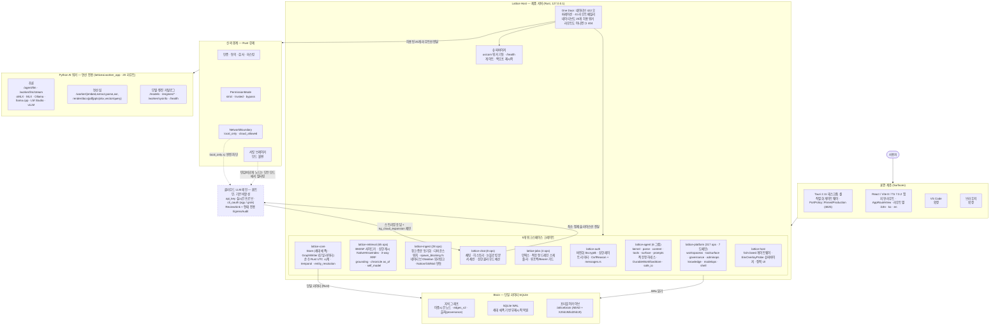
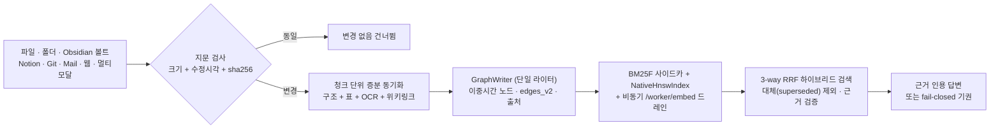

 

# Lattice AI 현재 아키텍처

> **상태: 정본(canonical)** — 현재 릴리스와 동기화되는 최신 아키텍처 정본 문서입니다.
> 서브시스템 설계 원칙과 운영 관점 개요는 [`docs/ko/architecture-overview.md`](./architecture-overview.md)를 참고하세요.

현재 릴리스: **14.1.1 — Living Synthesis**.

Lattice AI는 단일 라이터 Rust 제품 호스트(`lattice-host`), 20개 라우트의 루프백 Python AI 연산 워커(`latticeai.worker_app`), 로컬 SQLite 지식 그래프, 모델 비종속 범용 적응형 에이전트 하네스(Universal Adaptive Agent Harness), 엄격 모드 TypeScript 7 / React / Vite 8 UI로 구성된 로컬 우선 Digital Brain 플랫폼입니다.

## 시스템 맵

## Rust 워크스페이스 (9개 크레이트)

| 크레이트 | 책임 | 주요 모듈 |
| --- | --- | --- |
| `lattice-host` | 제품 컴포지션 루트, One Door 라우터, fail-closed 무리다이렉트 프록시 클라이언트, 정적 UI 서버, `EnvOverlayProbe` 워커 슈퍼바이저 | `gateway/mod.rs`, `gateway/onedoor.rs`, `gateway/product.rs`, `supervisor/` |
| `lattice-core` | 무재시작 복원 세대 에폭 및 단일 라이터 풀 `Store`, `GraphWriter`, 통합 Rust ↔ Python 오프셋 없는 UTC 시계(`libc` `unsafe` 제거), 이중시간(`temporal.rs`), 엔티티 해소, 무결성 검사기, `EmbeddingModelRegistry`, 멱등 워커 클라이언트 | `graph_write/`, `integrity/`, `temporal.rs`, `entity_resolution.rs`, `embedding_registry.rs`, `worker.rs` |
| `lattice-auth` | 버전화 `$scrypt$` 비밀번호 해싱(`Result` 반환, 레거시 검증 호환), 상한 메모리 레이트 리미터 및 통합 HTTP `429` + `Retry-After` 계약, 세션 저장소, CSRF Origin 가드(`CsrfReason` 열거형 + `messages.rs`) | `password.rs`, `ratelimit.rs`, `session.rs`, `csrf.rs`, `messages.rs`, `config.rs` |
| `lattice-agent` | 안전 커널, 범용 적응형 에이전트 하네스(`probe.rs` 3턴 마이크로 프로빙, `ui_resolve.rs`, `rag_grounding.rs`), fail-closed 검증기, `DurableWorkflowStore`, 5역할 `MultiAgentSession`, TOCTOU 방지 `safe_io`(Unix `openat`/`O_NOFOLLOW` + Windows 핸들 고정 탐색) | `kernel/`, `parse/`, `content/`, `tools/`, `surface/`, `prompts/` |
| `lattice-retrieval` | 사전 토큰화 BM25F 사이드카(`bm25_node_stats`), 상한 캐시 순수 Rust `NativeHnswIndex`, 3-way BM25F+Vector+Graph RRF 하이브리드 검색, 주장 단위 근거 검증·기권, `as_of` 시점 조회, Self-Model, Brain 거버넌스 API | `bm25/`, `native_hnsw.rs`, `hybrid.rs`, `grounding.rs`, `brain_api/`, `chronicle_api/`, `self_model.rs` |
| `lattice-ingest` | 청크 단위 증분 동기화, `DebouncedWatchEngine`, 논블로킹 `spawn_blocking` 로컬 파일시스템 API, PDF/표/OCR 구조 보존, `GraphWriter` 기반 네이티브 Obsidian(`[[wikilink]]` `LINKS_TO` 엣지) 및 Notion/Git/Mail 연동 브릿지 | `incremental_sync.rs`, `incremental_watch.rs`, `document_structure.rs`, `local_files_api/{local.rs,folder.rs,interop.rs}` |
| `lattice-jobs` | 부분 진행 통계 보존과 루프백/Bearer 라우트 가드를 갖춘 백그라운드 임베딩 및 벡터 인덱스 드레인 스케줄러 | `index_api/{engine.rs,scheduler.rs,routes.rs}` |
| `lattice-platform` | 7개 도메인 라우트 패밀리: `workspaceos`, `toolsurface`(네이티브 `POST /mcp`, 도구, 플러그인, Computer Use), `governance`(검토함, 변경 제안, 훅, 워크플로), `knowledge`(포터빌리티, X25519/Ed25519 선택 서브그래프 공유, 네트워크 경계, 멀티모달, 음성), `modelops`, `adminops`, `shell` | `workspaceos/`, `toolsurface/`, `governance/`, `knowledge/`, `modelops/`, `adminops/`, `shell/` |
| `lattice-chat` | 근거 기반 채팅 오케스트레이션, 히스토리, 논블로킹 문서 세션 영속화, LRU 상한 클라우드 토큰 예산 추적, 네이티브 `ingest_generated`, 옵트인 클라우드 에스컬레이션 | `chat.rs`, `history.rs`, `documents.rs`, `cloud/budget.rs` |

크레이트 내부 소유권 지도는 [`rust/lattice-agent/ARCHITECTURE.md`](../../rust/lattice-agent/ARCHITECTURE.md)와 [`rust/lattice-platform/ARCHITECTURE.md`](../../rust/lattice-platform/ARCHITECTURE.md)에 있습니다.

## 지식 수집 및 검색 파이프라인

- **단일 라이터 SQLite (`GraphWriter`):** 모든 쓰기는 `lattice-core::graph_write`와 `Store::write_conn`으로 직렬화됩니다. `.latticebrain` 아카이브 복원 시 스토어 세대 에폭이 증가해 기존 커넥션이 자동 교체되므로 호스트 재시작이 필요 없습니다.
- **네이티브 연동 브릿지:** `POST /api/ingestion/obsidian`은 `.md` 노트를 파싱하고 `[[wikilink]]` 참조에서 `LINKS_TO` 엣지를 `GraphWriter`로 직접 생성합니다. `POST /api/ingestion/interop`은 사용자 승인 토큰 하에 Notion 디렉터리/`.zip` 내보내기, 로컬 Git 커밋 로그, `.eml`/`.ics` 메일·캘린더 파일을 네이티브 Rust로 인제스트합니다.
- **근거 기반 검색 및 거버넌스:** 활성 주장과 대체(superseded) 주장을 쿼리 시점에 분리하며(`include_historical = false` 기본), `as_of` 시점 여행과 `grounding.rs` 주장 검증을 제공합니다. 워크스페이스 격리 무결성 검사·복구, 엔티티 병합, 지식 교정, 섀도 임베딩 전환은 `brain_api`를 통해 실행됩니다.

## Python AI 워커 및 크로스플랫폼 모델 런타임

`latticeai.worker_app`(`create_worker_app`)은 **20개** 허용 라우트만 제공하는 루프백 전용 연산 워커이며 `worker_resilience.py`(`x-lattice-idempotency-key` 병합 및 단항 타임아웃 격리), `ContextVar` 기반 LLM 라우터 의존성 주입(`lattice_brain.graph.runtime.llm_router_scope`), 사전 컴파일·비동기 지원 폴백 임베딩(`lattice_brain.embeddings`), 상한 레이트·프록시 보안 프리미티브(`latticeai.core.security`)를 제공합니다.

- **크로스플랫폼 엔진 어댑터 (`latticeai/services/engine_adapters.py`):**
  - **macOS (Apple Silicon):** `omlx`(Homebrew 또는 `~/.omlx/venv` 무-Homebrew universal2 휠 폴백) 계층형 RAM/SSD KV 캐시 및 실시간 가용 메모리 압박 자동 튜닝(`host_available_ram_gb`, `omlx_serve_args`), `local_mlx`(`pyproject.toml`에서 `darwin`/`arm64` 플랫폼 가드 적용), `ollama`, `lmstudio`, `llamacpp`.
  - **Windows:** `winget` 무인 설치(`ollama`, `llamacpp`, `lmstudio`) 및 `pip install llama-cpp-python[server]` 자동 폴백.
  - **Linux:** 공식 Ollama 설치 스크립트 및 `pip` `llamacpp` / `vllm`, 양자화 KV GPU 서빙(`llamacpp_serve_args`).
- **모델 라우팅:** `Qwen3.8-27B-4bit`는 32GB+ Apple Silicon Mac에서 `mlx-community/Qwen3.8-27B-4bit`로, Windows/Linux에서는 공개 GGUF 경로(`ggml-org/Qwen3.8-27B-GGUF` / `unsloth/Qwen3.8-27B-GGUF`)로 자동 매핑되며 `HF_XET_HIGH_PERFORMANCE=1`이 기본 활성화됩니다.

## 표면 계층, 툴체인 및 검증 게이트

- **프론트엔드 (`frontend/src`):** `strict`, `noUncheckedIndexedAccess`, `noImplicitReturns`, `noFallthroughCasesInSwitch`, `noUnusedLocals`, `noUnusedParameters`, `verbatimModuleSyntax`를 강제하는 React + Vite 8 + TypeScript 7.0.2 (`tsgo`), 네이티브 ESM 설정([`vite.config.mts`](../../vite.config.mts), [`vitest.config.mts`](../../vitest.config.mts)), 모듈화된 라우트 디스패치(`AppRouteView.tsx`), 라우트별 지연 로딩 및 i18n 네임스페이스(`ko`, `en`), SSR/비-DOM 안전 가드, 모든 라우트·패널 `ErrorBoundary` 격리.
- **데스크톱 및 확장:**
  - **Tauri 2.11 (`src-tauri/`):** 직렬화된 비동기 게이트웨이 생명주기(`start`/`stop`/`restart`), 프로덕션 빌드가 포트 `4825` 충돌 시 즉시 실패(fail-fast)하도록 고정하는 `PortPolicy::PinnedProduction`, 비실패 커맨드(`backend_status`, `shutdown_backend`)의 직접 `BackendStatus` 반환, 루프백 검증 외부 오리진 처리, `spawn_blocking` 기반 `/usr/bin/osascript` 폴더 선택기, `'unsafe-inline'`을 제거한 엄격 CSP 및 `127.0.0.1:4825` 고정 권한.
  - **VS Code 확장 (`vscode-extension/`):** 선택적 Bearer 인증, TTL 단일 사용 승인 토큰 캐시, HTTP/SSE 타임아웃 및 오류 가드, 실시간 설정 리로드, 크로스플랫폼 VSIX 패키징.
  - **브라우저 확장 (`browser-extension/`):** 포트 4825 한정 호스트 권한 및 선택적 사용자 지정 포트, 라이브 DOM 가시성 추출, UTF-8 바이트 예산 절단, 종단간 본문 타임아웃 제어.
- **무-TS5 OpenAPI 코드 생성:** [`scripts/generate_openapi_types.mjs`](../../scripts/generate_openapi_types.mjs)가 TypeScript 5 의존성 없이 `frontend/openapi.json`에서 `frontend/src/api/openapi.ts`를 결정론적으로 생성합니다.
- **자동 검증 및 크로스플랫폼 CI 게이트:**
  - **프론트엔드:** `npm run test:frontend:coverage`(113개 테스트 파일 / 1,852개 테스트 4대 지표 100%), `tsc 7.0.2`(`noUncheckedIndexedAccess` 활성), 번들 예산(`<= 150 KiB` gzip), i18n 리터럴·네임스페이스 검증, 확장 테스트 스위트.
  - **Python:** `npm run test:coverage`(`>= 90%` 하한), `ruff`(`ruff format --check .`, `"BLE"` 광범위 예외 탐지, `C901` 예외 없는 전역 McCabe `max-complexity <= 20`, 프로덕션 `S608`, 최소 Bandit 파일별 예외), `mypy`, 도메인별 모듈화 단위 테스트(`tests/unit/`, 다중 타임존 UTC 타임스탬프 일관성 테스트 포함).
  - **Rust, Windows, 데스크톱 및 컨테이너:** `cargo fmt --check`, `cargo clippy --workspace --all-targets -- -D warnings`, **Ubuntu (`ubuntu-latest`)** 및 **Windows (`windows-latest`)** 병렬 `cargo-nextest`, **macOS (`macos-latest`)** `src-tauri` 테스트, 다이제스트 고정 멀티스테이지 `Dockerfile` 빌드 및 `lattice-host --version` 스모크 검증.
  - **문서 & 비주얼:** `docs:check-current`, `docs:check-links`, `docs:check-languages`(EN ↔ KO 100% 패리티), `check:max-file-lines`, **PR 및 `main`** Playwright `visual` 스모크, 릴리스 증거 바인딩.

## 로컬 우선 경계, 거버넌스 및 포터빌리티

- **제안 우선 거버넌스:** 신규 생성은 최소 마찰로 실행되며, 기존 사용자 파일 수정·삭제는 검토함(Review Center) 제안으로 스테이징되어 명시적 승인 후에만 반영됩니다.
- **네트워크 경계:** 기본값은 `local_only`입니다. 옵트인 `cloud_allowed`에서도 `sensitive` / `private` / `do_not_share` 노드는 양 모드 모두 차단되며, 상한 턴/세션 토큰 예산, 형태 전용 송출 감사, `kg_cloud_expansion` 제안 스테이징이 적용됩니다.
- **포터빌리티 및 선택적 Brain Network:** 전체 백업은 AEAD 암호화 `.latticebrain` 아카이브(v2 KDF)를 사용합니다. 선택적 서브그래프 공유는 옵트인(`LATTICEAI_BRAIN_NETWORK=1`)으로 X25519 봉인 암호화와 Ed25519 출처 서명을 적용하며 수신 측에는 제안으로만 도착합니다.

## 릴리스 산출물 맵

14.1.1 정확 버전 산출물 이름:

- Python 휠: `dist/ltcai-14.1.1-py3-none-any.whl`
- Python sdist: `dist/ltcai-14.1.1.tar.gz`
- npm tarball: `ltcai-14.1.1.tgz`
- VS Code / Cursor / Antigravity 확장: `dist/ltcai-14.1.1.vsix`
- macOS Apple Silicon DMG: `src-tauri/target/release/bundle/dmg/Lattice AI_14.1.1_aarch64.dmg`

## 알려진 경계

- **PostgreSQL 백엔드:** 내보내기/상태 표면은 정직하게 `planned`로 표시되며 SQLite WAL이 정본 단일 라이터입니다.
- **실시간 메일박스/시스템 캘린더 연동:** 의도적으로 범위 밖이며 `mail` 연동 브릿지는 로컬 `.eml`/`.ics` 파일만 처리합니다.
- **남은 로드맵 항목:** [`docs/ko/ROADMAP.md`](./ROADMAP.md)와 [`docs/ko/FEATURE_STATUS.md`](./FEATURE_STATUS.md)에서 추적합니다.
