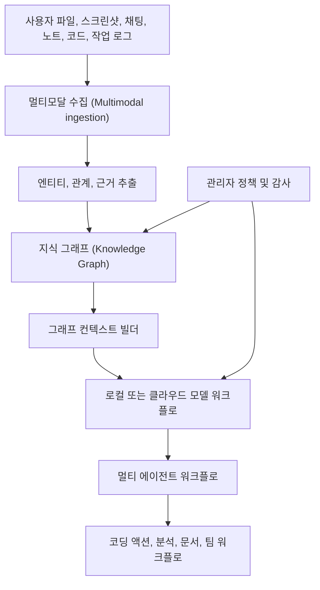

[](../architecture.md) [](./architecture-overview.md)

# Lattice AI 아키텍처 개요 (v3.6.0 역사적 스냅샷)

> **상태: 역사적 기록(Historical)** — 배경 맥락을 위해 보존된 하위 시스템 노트입니다. 현재 릴리스와 동기화되는 표준 아키텍처 문서는 [`ARCHITECTURE.md`](./ARCHITECTURE.md)(영문 원본: [`ARCHITECTURE.md`](../../ARCHITECTURE.md))입니다. 이 파일은 v3.6.0 Knowledge Graph First 아키텍처의 세부 사항을 보존하며, 버전과 하위 시스템 설명은 당시 시점으로 고정되어 있습니다.

> v3.6.0 — **Knowledge Graph First.** 모든 데이터 소스는 단일 통합 수집 파이프라인(`lattice_brain/ingestion/pipeline.py`)을 통해 정형화된 엔티티/관계([`docs/kg-schema.md`](./kg-schema.md)), 브라우저/웹 입력, 노드별 출처 이력(provenance), 로컬 내보내기/가져오기/백업(`lattice_brain/portability/`)과 함께 하나의 그래프로 수렴합니다. 에이전트 생태계, 장기 기억, 스킬/훅/도구/MCP 레지스트리는 모두 `/app`에서 조작 가능합니다.

Lattice AI는 로컬 우선(local-first) **디지털 브레인 플랫폼(Digital Brain Platform)**입니다. 아키텍처는 영속적인 중심이자 사용자의 자산인 **Knowledge Graph**를 중심으로 구성됩니다. 모델, 도구, 에이전트, RAG, 워크플로, UI 모드는 그래프 컨텍스트 위에서 작동하는 교체 가능한 계층입니다. 모델은 교체 가능하지만 지식은 영속적입니다.

## 아키텍처 목표

- 사용자 지식을 기본적으로 로컬 우선으로 유지합니다.
- 멀티모달 입력을 부가 기능이 아닌 기본 경로로 취급합니다.
- 근거, 의사결정, 파일, 아티팩트, 작업 이력을 보존합니다.
- 모델을 언제든 교체 가능하고 정책으로 통제 가능한 상태로 유지합니다.
- 기능을 숨기는 대신 위험 요소와 출처 사실을 투명하게 설명합니다.
- 기본 모드(Basic mode)와 고급 모드(Advanced mode)의 기능 동등성을 유지합니다.
- 관리자 전용 기능을 명시적이고 감사 가능하게 유지합니다.

## 워크스페이스 뷰



## 영속적 코어 (Durable Core)

Knowledge Graph는 영속적인 개인 및 조직 워크스페이스 컨텍스트를 저장합니다.

- 파일 및 문서 근거
- 이미지 및 스크린샷
- 대화 및 노트
- 사용자 의사결정
- 작업 이력
- 생성된 아티팩트
- 에이전트 및 워크플로 이벤트

모델은 제품의 코어가 아닙니다. 모델은 워크스페이스 파이프라인의 교체 가능한 참여자입니다.

## 멀티모달 수집 (Multimodal Ingestion)

Lattice AI는 사용자가 원본 자료를 그대로 제공할 것이라고 가정합니다. 지원하는 입력 유형은 다음과 같습니다.

- PDF
- Word
- Excel
- PowerPoint
- 이미지
- 스크린샷
- 채팅 기록
- 노트
- 웹 콘텐츠
- 코드
- 작업 로그

아키텍처는 AI가 작업하기 전에 사용자에게 이러한 자료들을 일반 텍스트로 먼저 변환하라고 요구해서는 안 됩니다.

## 로컬 모델 관리 정책

로컬 추천 모델은 멀티모달을 기본으로 합니다.

- macOS Apple Silicon: MLX-VLM 우선(표준 Gemma 4 메타데이터에 한해 MLX-LM 텍스트 폴백 유지). Gemma 4 12B `gemma4_unified`는 `mlx_vlm.models.gemma4_unified`를 포함한 MLX-VLM 런타임을 필요로 합니다.
- Windows: llama.cpp 멀티모달 경로 및 사용자 친화적인 LM Studio 옵션.
- Linux: GPU 지원 여부에 따른 llama.cpp 또는 vLLM 멀티모달 경로.
- Ollama: 기본 우선순위가 아닌 선택적 옵션으로 유지.

저사양 머신은 더 작거나 양자화된 멀티모달 모델을 사용합니다.

## 모델 출처 공개 (Model Source Disclosure)

모델 카탈로그 엔트리는 다음 다섯 가지 출처 공개 필드를 포함합니다.

1. `source_country` (출처 국가)
2. `source_company` (개발 기업/조직)
3. `execution_method` (실행 방식)
4. `internet_requirement` (인터넷 연결 필요 여부)
5. `model_name` (모델 이름)

이 항목들은 고급 모드 전용 메타데이터가 아니라 1급(first-class) 모델 사실 정보입니다.

## 추천 흐름 (Recommendation Flow)

```text
하드웨어 스캔 (hardware scan)
  -> CPU/GPU/RAM/디스크/OS 분석
  -> 멀티모달 모델 후보군 압축
  -> 동일 패밀리 내 구세대 모델 제외
  -> 출처 정보 공개 (source disclosure)
  -> 추천 사유 제시 (recommendation reason)
  -> 다운로드 / 설치 / 로드 / 검증
```

현재 기본 추천 패밀리는 Gemma 4입니다. Qwen3.6 및 Qwen3.5가 현재 멀티모달 대안이며, GPT-OSS 20B와 LFM2.5 2.6B가 범용 및 초경량 텍스트 전용 티어를 담당합니다. 이전 세대 패밀리(Qwen3-VL, Llama 4, Qwen2.5-VL, Llama 3.2 Vision)는 이미 다운로드된 가중치가 계속 작동하도록 기능 레지스트리에 *인식된(recognised)* 항목으로 남아 있지만 카탈로그나 새 다운로드 경로에는 노출되지 않습니다. 자세한 내용은 [`MODEL_POLICY.md`](./MODEL_POLICY.md)를 참조하십시오.

## 모드 (Modes)

기본 모드와 고급 모드는 동일한 기능 접근 권한을 가집니다.

- 기본 모드는 평이한 언어와 출처 사실을 사용합니다.
- 고급 모드는 실행, 메모리, 양자화, 로드/언로드 세부 정보를 추가로 보여줍니다.
- 관리자 모드는 실제 관리 권한(사용자 관리, 권한, 감사 로그, 조직 정책, 보안 정책, 민감 데이터 모니터링, 모델 승인 정책, Private VPC)을 추가합니다.

## 주요 모듈 (v3.6.0 당시 기준)

| 모듈 | 역할 |
| --- | --- |
| `latticeai/services/model_catalog.py` | 멀티모달 모델 카탈로그, 출처 메타데이터, 별칭 |
| `latticeai/services/model_recommendation.py` | 하드웨어 인식 멀티모달 모델 추천 |
| `latticeai/services/model_runtime.py` | 다운로드, 로드, 서버 및 모델 워크플로 오케스트레이션 |
| `llm_router.py` | MLX-VLM/MLX-LM 및 OpenAI 호환 모델 라우팅 |
| `knowledge_graph.py` | 그래프 저장소, 추출, 로컬 폴더 지식 그래프 컨텍스트 |
| `latticeai/core/context_builder.py` | 생성을 위한 그래프 컨텍스트 조립 |
| `latticeai/core/workspace_os.py` | 워크스페이스 상태, 타임라인, 스냅샷, 영속 컨텍스트 |
| `lattice_brain/runtime/multi_agent.py` | Planner/executor/reviewer/researcher 오케스트레이션 |
| `lattice_brain/workflow.py` | 워크플로 정의 및 실행 이력 |
| `latticeai/core/plugins.py` | 플러그인 매니페스트, 레지스트리, 권한 경계 |
| `latticeai/core/security.py` | 로컬 보안 프리미티브 |

## 호환성

v2.2.1은 v2.x의 추가적(additive) 워크스페이스 및 API 호환성 기조를 보존합니다. 기존 그래프 및 워크스페이스 데이터는 비파괴적으로 마이그레이션됩니다.
