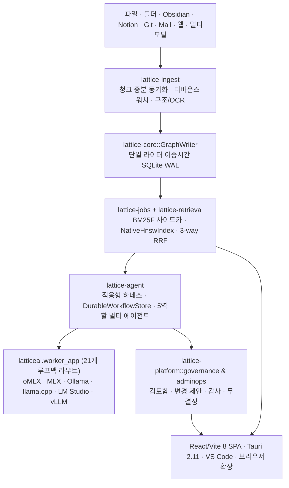

 

# Lattice AI 서브시스템 및 설계 개요

> **상태: 정본(canonical)** — 현재 릴리스 기준의 서브시스템 설계 원칙과 구성 개요 문서입니다.
> 전체 시스템 맵, 크레이트 인벤토리, 정확 버전 산출물 맵은 [`ARCHITECTURE.md`](./ARCHITECTURE.md)(영문 정본: [`ARCHITECTURE.md`](../../ARCHITECTURE.md))를 참고하세요.

현재 릴리스: **14.3.0 — Temporal Synthesis**.

Lattice AI는 로컬 우선(local-first) **디지털 브레인 플랫폼(Digital Brain Platform)**입니다. 아키텍처는 사용자가 소유하는 단일 영속 중심인 단일 라이터 SQLite **지식 그래프(Knowledge Graph)**(`lattice-core::graph_write`)를 축으로 구성됩니다. 모델, 추론 엔진, 도구, 에이전트, 검색 인덱스, 워크플로, UI 표면은 모두 검증된 그래프 컨텍스트 위에서 작동하는 교체 가능한 계층입니다. 모델은 교체 가능하지만 지식은 영속적입니다.

## 핵심 설계 원칙

- **기본 로컬 우선:** 사용자가 클라우드 에스컬레이션을 명시적으로 활성화하지 않는 한, 지식, 세션, 벡터, 감사 로그는 `local_only` 네트워크 정책 아래 로컬 머신에만 보관됩니다.
- **단일 라이터 영속성:** 모든 지식 그래프 쓰기는 Rust의 `lattice-core::graph_write::GraphWriter` 및 `Store::write_conn`으로 직렬화됩니다. `.latticebrain` 아카이브 복원 시 스토어 세대 에폭이 증가하여 `lattice-host` 재시작 없이도 기존 풀 커넥션이 안전하게 교체됩니다.
- **신뢰·제어는 Rust, AI 연산은 Python:** `lattice-host`가 인증(`$scrypt$`·세션·상한 레이트 리미트·CSRF), 워크스페이스 격리, 제안 우선 거버넌스, TOCTOU 방지 워크스페이스 I/O(`safe_io`), 허용 목록 송출을 강제하며, `latticeai.worker_app`은 추론·임베딩·파싱·OCR/ASR·문서 렌더링을 위한 21개 루프백 연산 라우트만 노출합니다.
- **모델 비종속 적응형 실행:** 에이전트 하네스(`lattice-agent`)는 모델 이름으로 분기하지 않고 런타임 마이크로 프로빙(`probe.rs`)으로 모델 역량을 실측하여 `standard`, `compact`, `guided` 다이얼을 동일한 fail-closed 권한·검증 게이트 아래 운영합니다.
- **투명한 역량 및 출처 공개:** 모델 카탈로그 항목은 출처 계층(`Origin Country -> Vendor -> Execution`), 인터넷 요구 사항, 양자화 및 메모리 정보를 1급 필드로 공개합니다.
- **일관된 모드와 명시적 관리자 권한:** 기본 모드와 고급 모드는 동일한 워크스페이스 기능을 제공하며, 관리자 모드는 사용자·조직·보안 정책·감사 거버넌스 권한을 명시적으로 분리합니다.

## 종단간 워크스페이스 흐름

## 영속적 코어 및 멀티모달 수집

지식 그래프([`docs/ko/kg-schema.md`](./kg-schema.md))는 이중시간 유효성(`valid_from`, `valid_until`, `superseded_by`)과 출처(provenance)를 갖춘 영속적 개인·조직 워크스페이스 컨텍스트를 저장합니다.

- 표·페이지·OCR 구조를 보존한 문서(PDF, Word, Excel, PowerPoint, Markdown, HTML, 코드)
- 이미지, 스크린샷, 오디오, 비디오 메타데이터(`Modality::Video`)
- 대화, 노트, Obsidian `[[wikilink]]` `LINKS_TO` 그래프, Notion / Git / `.eml` / `.ics` 연동 임포트
- 사용자 의사결정, 지식 교정, 엔티티 별칭, 생성 산출물, 영속 워크플로·에이전트 출처 엣지(`USED_BY_AGENT`, `GENERATED_BY`)

## 로컬 모델 런타임 및 추천 정책

하드웨어 인식 모델 추천(`latticeai/services/model_catalog.py`, `latticeai/services/model_recommendation.py`, `latticeai/services/engine_adapters.py`)은 로컬 머신의 OS, GPU/통합 메모리, 실시간 가용 RAM에 맞춰 엔진과 모델을 구성합니다.

- **macOS (Apple Silicon):** `omlx`(실시간 메모리 압박 자동 튜닝 계층형 RAM/SSD KV 캐시) 및 `local_mlx`(`darwin`/`arm64` 플랫폼 가드 적용), `ollama`, `lmstudio`, `llamacpp`.
- **Windows:** `winget` 기반 `ollama`, `llamacpp`, `lmstudio` 및 `pip install llama-cpp-python[server]` 자동 폴백.
- **Linux:** 공식 Ollama 설치 스크립트 및 양자화 KV GPU 플래그를 지원하는 `llamacpp` / `vllm` 서빙 어댑터.

모든 카탈로그 항목은 1급 출처 공개 필드(`source_country`, `source_company`, `execution_method`, `internet_requirement`, `model_name`)를 제공합니다. 전체 정책과 지원 모델 패밀리(Qwen3.8, Gemma 4, EmbeddingGemma 2 등)는 [`MODEL_POLICY.md`](./MODEL_POLICY.md)를 참고하세요.

## 정본 서브시스템 맵

| 계층 | 정본 경로 | 책임 |
| --- | --- | --- |
| 제품 호스트 | `rust/lattice-host/src/gateway/`, `supervisor/` | One Door 422 오퍼레이션 라우터, fail-closed 워커 프록시, 정적 UI 서빙, 워커 프로세스 슈퍼바이저 |
| 코어 & 저장소 | `rust/lattice-core/src/{db.rs,graph_write/,integrity/,temporal.rs,entity_resolution.rs,embedding_registry.rs}` | 단일 라이터 SQLite WAL 스토어, 세대 에폭 무재시작 복원, 통합 오프셋 없는 UTC 시계, 무결성 복구, 이중시간 사실, 엔티티 해소, 섀도 임베딩 레지스트리 |
| 인증 & 보안 | `rust/lattice-auth/src/{password.rs,ratelimit.rs,session.rs,csrf.rs,messages.rs}` | 버전화 `$scrypt$` 해싱, 상한 레이트 리미팅(`429` + `Retry-After`), 세션, CSRF 가드(`CsrfReason` + `messages.rs`) |
| 검색 & Brain API | `rust/lattice-retrieval/src/{bm25/,native_hnsw.rs,hybrid.rs,grounding.rs,brain_api/,chronicle_api/}` | 사전 토큰화 BM25F, 상한 순수 Rust HNSW, 3-way RRF, 주장 근거 검증·기권, Brain 거버넌스 엔드포인트 |
| 수집(Ingestion) | `rust/lattice-ingest/src/{incremental_sync.rs,incremental_watch.rs,document_structure.rs,local_files_api/}` | 청크 증분 동기화, 디바운스 OS 워치, `spawn_blocking` 로컬 파일 API, 네이티브 Obsidian/Notion/Git/Mail 브릿지 |
| 에이전트 하네스 | `rust/lattice-agent/src/{kernel/,parse/,content/,tools/,surface/,prompts/}` | 범용 적응형 하네스, fail-closed 검증기, 영속 DAG 워크플로, 5역할 멀티 에이전트 세션, TOCTOU 방지 `safe_io` |
| 플랫폼 표면 | `rust/lattice-platform/src/{workspaceos/,toolsurface/,governance/,knowledge/,modelops/,adminops/,shell/}` | Workspace OS, 네이티브 MCP·도구, 검토함·변경 제안, `.latticebrain` 포터빌리티·Brain Network, 셋업·카탈로그, 관리자 감사 |
| 채팅 & 잡 | `rust/lattice-chat/src/`, `rust/lattice-jobs/src/` | 근거 기반 채팅, 논블로킹 문서 세션, 상한 클라우드 예산, 백그라운드 임베딩·인덱스 드레인 |
| Python 연산 워커 | `latticeai/worker_app.py`, `latticeai/api/worker_seams.py`, `latticeai/services/{engine_adapters.py,model_runtime/}`, `lattice_brain/` | 21개 루프백 추론·임베딩·파싱·문서 렌더링 라우트 및 크로스플랫폼 엔진 생명주기 |
| 프론트엔드 & 확장 | `frontend/src/`, `src-tauri/src/`, `vscode-extension/`, `browser-extension/` | 엄격 TypeScript 7 (`noUncheckedIndexedAccess`) / React / Vite 8 SPA, Tauri 2.11 데스크톱 셸(`PortPolicy::PinnedProduction` 포트 `4825`), VS Code 확장, 브라우저 캡처 확장 |

## 호환성 및 업그레이드

14.3.0은 `nodes`의 `source_uri`·`filename` 표현식 인덱스를 추가 방식으로만 반영하며 파괴적 마이그레이션이 없습니다. 시간 사전 필터와 그래프·브레인·검색 `LIMIT` 조회에 워크스페이스·뷰어 범위를 선적용하고, 공유 번들 내보내기/가져오기를 강화했으며, 채팅 검색의 IDF/BM25F 관련도 랭킹, `as_of` 유효기간 평가, 엄격한 Self-RAG 보류 및 데스크톱 UX 수정을 포함합니다. 상세 내용과 RAG 지표는 [14.3.0 릴리스 노트](./releases/RELEASE_NOTES_v14.3.0.md)를 참고하세요.
