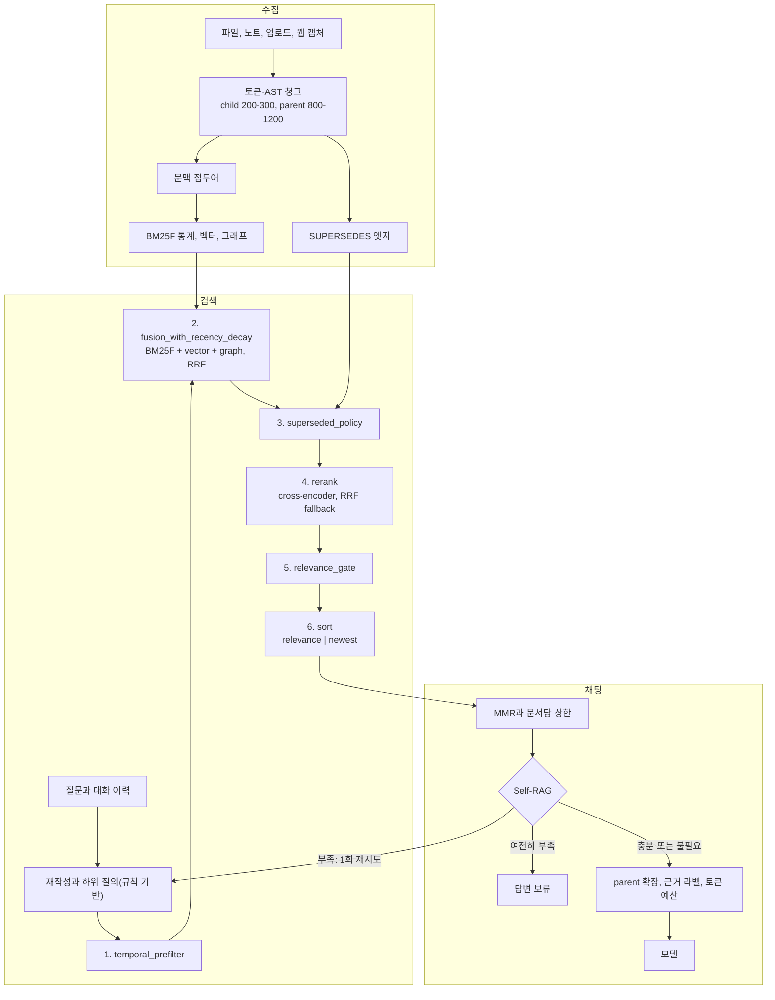

[](../../releases/RELEASE_NOTES_v14.2.0.md) [](./RELEASE_NOTES_v14.2.0.md)

# Lattice AI v14.2.0 — Temporal Synthesis

릴리스 날짜: **2026-11-27**

`v14.2.0`은 검색 파이프라인을 시간 중심으로 재구성했습니다. 토큰 크기와 문서 구조를 따르는 청크, 구버전(superseded) 처리를 포함한 시간 인식 랭킹, cross-encoder 재랭킹, 채팅의 다양성·근거 게이트, 3D 살아있는 Brain 화면, 고정 뷰포트 데스크톱 셸, `ltcai search` 명령이 추가되었고, 다중 사용자 개인정보 결함을 수정했습니다.

## 파이프라인



검색 엔드포인트는 1-6단계를 실행합니다. 재랭킹은 hybrid 검색, hybrid GraphRAG, 채팅 검색에 적용됩니다. 질의 재작성, MMR, Self-RAG 게이트는 채팅 전용입니다.

## 주요 변경

### 청킹과 수집

- 운영 수집 경로(노트, 브라우저 캡처, 업로드, 감시 폴더)에서 문자 창 대신 토큰 기준 청킹을 사용합니다. 추정기는 `lattice-core/src/tokens.rs`에 있으며 한글·CJK·문장부호에 ASCII 글자보다 큰 가중치를 둡니다.
- 기본 `parent_child` 모드: 200-300 토큰 child 청크(overlap 30)를 색인하고, 800-1200 토큰 parent 섹션을 중복 제거해 모델에 전달합니다. `flat` 모드는 300-500 토큰, overlap 48입니다.
- Rust, Python, TypeScript/TSX, JavaScript는 tree-sitter 구문 경계로 분할하며, 파싱 오류 시 기존 접두 분할기로 대체합니다.
- 각 청크에 결정적 문맥 접두어(문서 제목, 헤딩, 심볼, 청크 내부 키워드)를 붙여 BM25F와 임베딩에 모두 반영합니다. 저장된 청크 원문과 인용 위치는 바뀌지 않습니다. LLM 문맥 생성기는 없습니다.
- 감시 폴더 동기화는 하나의 쓰기 트랜잭션에서 리비전을 교체하고 오래된 청크·벡터·BM25F 통계·parent를 삭제하며 `document_version`을 기록합니다.
- parent 섹션은 새 추가형 `chunk_parents` 테이블에 저장되며 JSON 내보내기/가져오기, 공유 번들, 아카이브 그래프 내보내기에 포함됩니다.

### 임베딩과 재랭킹

- `LATTICEAI_EMBEDDING_PROVIDER` 기본값이 `auto`가 되었습니다. 로컬에서 가장 먼저 사용 가능한 항목을 고릅니다: 캐시된 Hugging Face 모델(`google/embeddinggemma-2` 768차원 우선, 다음 `embeddinggemma-300m`), 캐시된 MLX 임베딩 모델, 로컬 Ollama 서버에 이미 받아 둔 임베딩 모델. 모두 없거나 선택한 런타임이 실패하면 결정적 `lattice-local-hash-v1` 임베더(384차원)를 사용합니다.
- EmbeddingGemma 2에는 새 `rag` extra(`pip install "ltcai[rag]"`: `sentence-transformers>=6.1.0`, `transformers>=5.18.0`)와 캐시된 가중치가 필요합니다. 이 extra는 `all`에 포함되지 않습니다.
- 새 워커 라우트 `POST /worker/rerank`가 상위 20개 hybrid 후보를 `BAAI/bge-reranker-v2-m3`로 재채점해 상위 5개를 올립니다. 질의 시점에 가중치를 내려받지 않습니다. 런타임·모델 부재, 타임아웃, 잘못된 응답이면 RRF 순서를 유지합니다.
- 어휘 벡터를 시맨틱 모델 이름으로 반환하던 이전 임시 백엔드를 제거했습니다.
- 채팅 컨텍스트에 지식 검색 결과가 실제로 포함됩니다(최대 5개). 이전에는 로컬 채팅의 Knowledge 섹션이 항상 비어 있었습니다.

### 시간 인식 검색

- 단계 순서: `temporal_prefilter`, `fusion_with_recency_decay`, `superseded_policy`, `rerank`, `relevance_gate`, `sort`. 모든 응답의 `temporal`에 보고됩니다.
- 한국어·영어 시간 표현(예: "지난주", "since 2026-08-01", "v14 이후")이 `updated_at` 사전 필터가 됩니다. 구간 안에 관련 결과가 없으면 필터 없는 목록을 반환하고 대체 사유를 알립니다.
- 운영 호출 경로는 항상 최신성 감쇠를 적용합니다. 구버전 지식은 현재 상태를 묻는 질문에서는 제외하고, 과거를 묻는 질문에서는 감점(x0.35)합니다.
- `sort_by=relevance|newest|auto`(및 `include_historical`, `since`, `until`)는 `/api/search/{hybrid,keyword,vector,graph}`에서 동작합니다. `sort_by`는 커맨드 검색, MCP `knowledge_search`, `obsidian_search`도 받습니다. 문서 생성 컨텍스트와 메모리 recall도 같은 랭킹을 사용합니다(recall에는 `sort_by`가 없습니다).
- 이전 버전을 superseded로 표시하는 수집 경로:
  - 감시 폴더 증분 동기화(이전 리비전 청크 삭제).
  - 노트 수집(URL 읽기, 폴더 수집, Obsidian을 포함한 interop 가져오기, 감시 대체 경로), 브라우저 현재 탭 캡처, `POST /upload/document`. 이전 버전의 내용은 보존되며, 과거 내용을 다시 수집하면 되살아납니다.
  - 동일성 기준은 노드 타입, 워크스페이스, 소유자, 출처 타입, 출처 URI입니다. 업로드는 파일명으로 매칭하며 단어 겹침이 50% 이상이어야 합니다.
  - superseded가 발생하지 않는 경로: `/api/knowledge-graph/ingest` 노트, 가든 노트, 음성 캡처, 채팅 생성 파일, 선택 영역만 캡처, 캘린더 일정.

### 채팅 근거

- 규칙 기반의 대화 이력 반영 질의 재작성과 최대 2개의 하위 질의(재시도 시 최대 5개).
- MMR 다양화와 문서당 청크 상한.
- 각 근거에 `[updated: ... | status: ...]` 라벨을 붙이고, 모델에게 최신 active 항목을 우선하며 무엇이 바뀌었는지 말하도록 지시합니다.
- Self-RAG 게이트: 저장된 기록을 묻는 질문인데 근거가 부족하면 확장 질의로 한 번 재시도한 뒤 답변을 보류합니다(응답의 `abstention`, `grounding.status=no_context`). 일반 질문에는 적용하지 않습니다.
- 컨텍스트 예산은 `LATTICEAI_CONTEXT_WINDOW_TOKENS`에 비례합니다: (윈도우 - 응답 - 1024) x 45%, 1000-24000 토큰으로 제한(기본값에서 2304).

### 3D 살아있는 Brain과 데스크톱 셸

- 대화 홈과 기억 그래프가 그래프를 3D 뇌로 그립니다. 노드는 타입별로 두 반구에 배치되고, 발광 엣지, 블룸, 깊이 안개, 주변 입자가 적용됩니다. 성장은 실시간 노드·엣지 수를 따릅니다.
- 답변이 스트리밍되는 동안 검색 추적 경로의 노드와 인접 엣지가 점등됩니다. 노드를 선택하면 카메라가 이동하고 이웃이 강조됩니다. 구버전 노드는 흐리게 표시되며 숨길 수 있습니다.
- 3D/2D 전환은 기억됩니다. WebGL이 없으면 2D로 대체하며, 동작 줄이기 설정을 따릅니다.
- 폭 761px 이상에서는 창 자체가 스크롤되지 않습니다. 대화 중에는 셸 안에서 메시지 영역이 스크롤되고, 다른 화면은 각자의 콘텐츠 영역 안에서 스크롤됩니다.
- 프로스티드 글래스 패널, Brain Vital Pill(노드·시냅스 수와 Seed, Cortex, Neural Web, Lattice 단계; 폭 1240px 이상에서 표시), 인용·노드용 도킹 근거 패널, 관련도/최신순 정렬·화면 전환·노드 이동을 지원하는 Cmd/Ctrl+K 팔레트.

### CLI

```bash
ltcai search "릴리스 담당자" --sort newest --limit 5
```

실행 중인 서버(`GET /api/search/hybrid`)에 질의합니다. 옵션: `--sort relevance|newest`, `--limit 1-100`, `--host`, `--port`. 인증은 `LATTICEAI_API_TOKEN`을 사용합니다. 종료 코드: 0 성공, 1 실패, 2 사용법 오류, 3 연결 불가, 4 인증 실패. newest 정렬은 `LATTICEAI_RECENCY_SORT_TOP_K` 상한을 따릅니다.

## 보안·개인정보 수정

- **다중 사용자 모드의 대화 노출:** 채팅 턴은 공유 그래프에 복사되는데 그래프 읽기가 워크스페이스로만 필터링되어, 로그인한 사용자가 다른 사용자의 대화 본문을 검색할 수 있었습니다. 이제 타인 소유의 대화 파생 노드는 그래프, 검색, 컨텍스트, 메모리, Brain, 연대기, 커맨드 센터 읽기에서 숨깁니다. 마이그레이션은 없으며 단일 사용자 모드와 소유자 없는 노드는 그대로입니다.
- 로그인 사용자의 검색이 워크스페이스 목록을 잃지 않습니다(응답 형태를 잘못 읽어 범위가 비어 있었습니다).
- 다른 사용자가 소유한 내용을 다시 수집해도 소유권을 가져가지 않으며, 공유 노드는 최초 소유자를 유지합니다. 감시·수동 폴더 정리는 호출자 본인의 기록만 제거합니다.
- 업로드에 소유자와 워크스페이스를 기록하고 `/upload/document`에서 워크스페이스 멤버십을 확인합니다. 지식 그래프 수집은 정렬상 첫 워크스페이스를 임의로 고르지 않습니다.
- 이웃 노드 없이 청크 문서를 선택한 공유 번들을 수락할 때 외래 키 오류가 나지 않습니다. 새 번들은 문서의 청크 노드를 포함하고, 이미 발급된 번들은 가져올 때 복원합니다. 서명 형식은 그대로입니다.

## 환경 변수

| 변수 | 기본값 | 효과 |
| --- | --- | --- |
| `LATTICEAI_EMBEDDING_PROVIDER` | `auto` | 임베딩 제공자. 14.2.0 이전 기본값은 `hash`. |
| `LATTICEAI_EMBEDDING_AUTODETECT` | `on` | `0`이면 `auto`의 로컬 모델 탐지를 끕니다. |
| `LATTICEAI_VECTOR_DIM` | `384` (hash fallback) | 차원 재지정. |
| `LATTICEAI_RERANKER` | `auto` | 워커 측: `off`이면 cross-encoder 비활성화. |
| `LATTICEAI_RERANKER_MODEL` | `BAAI/bge-reranker-v2-m3` | 캐시된 모델 id 또는 로컬 디렉터리. |
| `LATTICEAI_RERANK` | `on` | 호스트 측 rerank 단계 스위치. |
| `LATTICEAI_RERANK_TIMEOUT_MS` | `2000` (50-15000) | RRF 순서로 되돌아가기 전 rerank 제한 시간. |
| `LATTICEAI_RERANK_CANDIDATES` | `20` (2-64) | 재채점하는 hybrid 후보 수. |
| `LATTICEAI_RERANK_PROMOTE` | `5` | 상단으로 올리는 결과 수. |
| `LATTICEAI_CHUNK_MODE` | `parent_child` | `flat`이면 300-500 토큰 단일 계층 청크. |
| `LATTICEAI_CONTEXTUAL_CHUNKS` | `on` | `0`이면 문맥 접두어를 붙이지 않습니다. |
| `LATTICEAI_AST_CHUNKS` | `on` | `0`이면 tree-sitter 분할을 끕니다. |
| `LATTICEAI_CONTEXT_WINDOW_TOKENS` | `8192` | 채팅 컨텍스트 예산 계산에 쓰는 모델 윈도우. |
| `LATTICEAI_RECENCY_HALF_LIFE_DAYS` | `60` (30-90) | 최신성 감쇠 반감기. |
| `LATTICEAI_RECENCY_DECAY_FLOOR` | `0.8` (0-1) | 감쇠 배수의 하한. |
| `LATTICEAI_RECENCY_SORT_TOP_K` | `12` (10-15) | newest 정렬 결과 상한. |
| `LATTICEAI_RELEVANCE_MIN_RATIO` | `0.3` | 최고 점수 대비 관련성 게이트. |
| `LATTICEAI_MMR` | `on` | `0`이면 MMR 다양화를 끕니다. |
| `LATTICEAI_MMR_LAMBDA` | `0.7` | 관련성과 다양성의 가중치. |
| `LATTICEAI_CHUNKS_PER_DOCUMENT` | `2` (1-3) | 문서당 상한. parent는 1회로 셉니다. |
| `LATTICEAI_SELF_RAG` | `on` | `0`이면 Self-RAG 게이트를 끕니다. |

## 평가

- Rust 검색 게이트(`rust/lattice-retrieval/tests/rag_eval.rs`)는 시간 상충 사례를 포함한 내장 픽스처에서 제품 검색기를 측정합니다: Recall@5/10, MRR, NDCG@10, 충실도(Faithfulness), 최신성 정확도(Recency Accuracy).
- 야간 워크플로(`.github/workflows/nightly-rag-eval.yml`)는 `datasets/rag_eval_v1.json`에 대해 `scripts/run_real_model_rag_eval.py`가 계산한 Recall@K, MRR, NDCG, Recency Accuracy를 보고합니다. 이 검색 수치는 스크립트 자체의 어휘 기반 시간 베이스라인에서 나오며 제품 검색기의 수치가 아닙니다. Faithfulness 등 생성 지표는 모델 엔드포인트가 설정된 경우에만 실행됩니다.

## 업그레이드 안내

- 기본값이 `auto`로 바뀌어, 로컬 모델이나 Ollama 임베딩 모델이 이미 있는 설치에서는 활성 임베더가 바뀔 수 있으며 색인이 `reindex_required`를 보고합니다.
- 색인 텍스트에 문맥 접두어가 포함되므로 기존 문서는 첫 동기화 때 한 번 다시 임베딩합니다. 파괴적 마이그레이션은 없습니다.
- 14.2.0 이전 업로드에는 소유자 기록이 없어, 로그인 사용자가 다시 올려도 superseded 처리되지 않습니다.

## 알려진 한계

- 이번 릴리스에서 실제 EmbeddingGemma 2 및 reranker 모델 로딩은 **검증하지 못했습니다**. 빌드 환경에 런타임과 가중치가 없었으며, 대체 경로(해시 임베딩, RRF 순서)만 확인했습니다.
- **워크스페이스 안에서 문서의 사용자별 비공개는 없습니다.** 문서와 업로드 읽기는 워크스페이스 범위이며 모든 사용자가 `personal` 워크스페이스를 가집니다. 뷰어 필터는 대화 파생 노드에만 적용됩니다. 관리자 내보내기와 백업에는 모두 포함됩니다.
- 수정된 노트·페이지·파일은 내용 주소 기반의 새 문서가 되며 이전 버전은 보존됩니다.
- 질의 재작성과 후속 질문 판별은 규칙 기반 휴리스틱입니다. 하위 질의의 벡터 검색은 원 질의 임베딩을 재사용합니다.
- 모델별 컨텍스트 윈도우 표가 없으므로 `LATTICEAI_CONTEXT_WINDOW_TOKENS`를 설정하세요.
- 시간 사전 필터는 전용 인덱스 없이 `nodes.updated_at`을 스캔합니다.
- `/rust/*` 검색·컨텍스트 라우트는 고정 패리티 경로로, 시간 매개변수를 보낼 때만 시간 랭킹을 적용합니다.

## 용어집

| 용어 | 이 제품에서의 의미 |
| --- | --- |
| Chunk | 색인 단위 조각. child 200-300 토큰(목표 250)과 parent 800-1200(목표 1000), flat 모드는 300-500(목표 400). |
| Overlap | 같은 섹션·심볼의 인접 청크가 반복하는 토큰: child 30, flat 48(12%), parent는 없음. |
| BM25F | 필드 가중 BM25 키워드 점수: 제목 3.0, 태그·헤딩(문맥 접두어 포함) 2.5, 본문 1.0, 메타데이터 0.6. |
| Embedding | 텍스트의 벡터 표현. EmbeddingGemma 2는 768차원, 해시 대체는 384차원. |
| RRF | Reciprocal Rank Fusion. BM25F·벡터·그래프 순위를 순위 위치로 결합(k = 60). |
| Reranker | 질의와 후보를 함께 읽는 cross-encoder. 상위 20개 후보를 재정렬하며 후보당 최대 1200자를 사용. |
| GraphRAG | 지식 그래프 관계로 확장하는 검색. |
| Temporal RAG | 시간을 고려한 검색: 구간 사전 필터, 최신성 감쇠, superseded 정책, 선택적 최신순 정렬. |
| MMR | Maximal Marginal Relevance. 관련성이 높으면서 서로 중복되지 않는 결과 선택(lambda 0.7). |
| Self-RAG | 근거가 답변을 뒷받침하는지 확인하고 한 번 재시도한 뒤 부족하면 보류하는 게이트. 여기서는 규칙 기반. |

## 정확한 배포 아티팩트

- Python wheel: `dist/ltcai-14.2.0-py3-none-any.whl`
- Python sdist: `dist/ltcai-14.2.0.tar.gz`
- npm tarball: `ltcai-14.2.0.tgz`
- VS Code / Cursor / Antigravity 확장: `dist/ltcai-14.2.0.vsix`
- macOS Apple Silicon DMG: `src-tauri/target/release/bundle/dmg/Lattice AI_14.2.0_aarch64.dmg`
