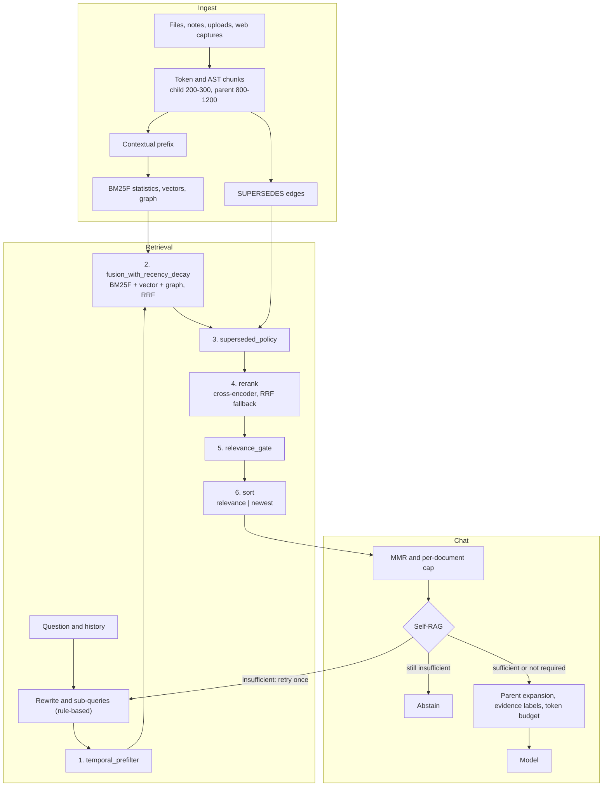

[](./RELEASE_NOTES_v14.2.0.md) [](../ko/releases/RELEASE_NOTES_v14.2.0.md)

# Lattice AI v14.2.0 — Temporal Synthesis

Release date: **2026-11-27**

`v14.2.0` rebuilds the retrieval pipeline around time: token-sized and structure-aware chunks, temporal ranking with superseded-version handling, cross-encoder reranking, diversity and grounding gates in chat, a 3D living brain view, a fixed-viewport desktop shell, and an `ltcai search` command. It also closes a multi-user privacy defect.

## Pipeline



Search endpoints run stages 1-6. Reranking applies to hybrid search, hybrid GraphRAG, and chat retrieval. Query rewriting, MMR, and the Self-RAG gate belong to chat.

## Highlights

### Chunking and ingestion

- Token-based chunking replaces character windows on the production ingest paths (notes, browser capture, upload, watch folders). The estimator lives in `lattice-core/src/tokens.rs` and weights Hangul, CJK, and punctuation more heavily than ASCII letters.
- Default `parent_child` mode: child chunks of 200-300 tokens (30 overlap) are indexed, and parent sections of 800-1200 tokens are returned to the model, deduplicated. `flat` mode uses 300-500 tokens with 48 overlap.
- Rust, Python, TypeScript/TSX, and JavaScript are split along tree-sitter syntax boundaries, with the previous prefix splitter as the fallback on parse errors.
- Each chunk gets a deterministic contextual prefix (document title, heading, symbol, chunk-local keywords) that feeds both BM25F and embeddings. The stored chunk text and citation offsets are unchanged. No LLM contextualizer exists.
- Watch-folder sync replaces a revision in one write transaction, purges stale chunks, vectors, BM25F statistics, and parents, and records `document_version`.
- Parent sections are stored in the new additive `chunk_parents` table and travel through JSON export/import, share bundles, and archive graph export.

### Embeddings and reranking

- `LATTICEAI_EMBEDDING_PROVIDER` now defaults to `auto`. It picks the first locally available option: a cached Hugging Face model (`google/embeddinggemma-2` at 768 dimensions first, then `embeddinggemma-300m`), a cached MLX embedding model, or an embedding model already pulled in a local Ollama server. With none of these, or when the chosen runtime fails, the deterministic `lattice-local-hash-v1` embedder (384 dimensions) is used.
- EmbeddingGemma 2 needs the new `rag` extra (`pip install "ltcai[rag]"`: `sentence-transformers>=6.1.0`, `transformers>=5.18.0`) and cached weights. The extra is not part of `all`.
- The new worker route `POST /worker/rerank` rescores the top 20 hybrid candidates with `BAAI/bge-reranker-v2-m3` and promotes the top 5. Weights are never downloaded at query time. A missing runtime or model, a timeout, or a malformed reply keeps the RRF order.
- Earlier placeholder backends that returned lexical vectors under semantic model names were removed.
- Chat now actually includes knowledge matches (up to 5); the Knowledge section of local chat context was previously always empty.

### Temporal retrieval

- Stage order: `temporal_prefilter`, `fusion_with_recency_decay`, `superseded_policy`, `rerank`, `relevance_gate`, `sort`. Every response reports it under `temporal`.
- Korean and English time expressions (for example "last week", "since 2026-08-01", "after v14") become an `updated_at` prefilter. If nothing relevant falls in the window, the unfiltered list is returned and the fallback is reported.
- Recency decay is always applied by production callers. Superseded knowledge is excluded for current-state questions and penalised (x0.35) for historical ones.
- `sort_by=relevance|newest|auto` (plus `include_historical`, `since`, `until`) works on `/api/search/{hybrid,keyword,vector,graph}`. `sort_by` is also accepted by command search, MCP `knowledge_search`, and `obsidian_search`. Document generation context and memory recall use the same ranking (recall has no `sort_by`).
- Which ingest paths mark older versions superseded:
  - Watch-folder incremental sync (old revision chunks are purged).
  - Note ingestion (read URL, folder ingest, interop imports including Obsidian, watch fallback), browser current-tab capture, and `POST /upload/document`. Older versions keep their content; re-ingesting earlier content revives it.
  - Identity is node type, workspace, owner, source type, and source URI. Uploads match on filename and also need at least 50% word overlap.
  - Never superseding: `/api/knowledge-graph/ingest` notes, garden notes, voice captures, chat-generated files, selection-only captures, and calendar events.

### Chat grounding

- Rule-based history-aware query rewrite with up to 2 sub-queries (up to 5 on retry).
- MMR diversification and a per-document chunk cap.
- Each evidence item is labelled `[updated: ... | status: ...]`, and the model is told to prefer the newest active item and say what changed.
- Self-RAG gate: when a question refers to your saved records and the retrieved evidence is insufficient, chat retries once with expanded queries and then abstains (`abstention` in the response, `grounding.status=no_context`). General questions are not gated.
- Context budget scales with `LATTICEAI_CONTEXT_WINDOW_TOKENS`: (window - reply - 1024) x 45%, clamped to 1000-24000 tokens (2304 at the defaults).

### 3D living brain and desktop shell

- Brain Chat Home and the Memory Graph render the graph as a 3D brain: nodes placed in two hemispheres by type, glowing edges, bloom, depth fog, and ambient dust. Growth follows live node and edge counts.
- Nodes and nearby edges light up along the retrieval trace while an answer streams. Selecting a node moves the camera and highlights its neighbours. Superseded nodes are dimmed and can be hidden.
- A 3D/2D toggle is remembered. Without WebGL the view falls back to 2D, and reduced-motion preferences are respected.
- At widths of 761px and above the window itself no longer scrolls. In an active chat the message stream scrolls inside the shell; other views scroll inside their content pane.
- Frosted-glass panels, a Brain Vital Pill (node and synapse counts and stage Seed, Cortex, Neural Web, Lattice; shown at 1240px and wider), a docked evidence panel for citations and nodes, and a Cmd/Ctrl+K palette with relevance/newest sorting, view switching, and node jump.

### CLI

```bash
ltcai search "release owner" --sort newest --limit 5
```

Queries a running server (`GET /api/search/hybrid`). Options: `--sort relevance|newest`, `--limit 1-100`, `--host`, `--port`. Authentication uses `LATTICEAI_API_TOKEN`. Exit codes: 0 success, 1 failure, 2 usage, 3 unreachable, 4 authentication. Newest order is capped by `LATTICEAI_RECENCY_SORT_TOP_K`.

## Security and privacy fixes

- **Conversation leak in multi-user mode:** chat turns are copied into the shared graph, and graph reads filtered by workspace only, so one signed-in user could retrieve another user's chat text. Conversation-derived nodes owned by someone else are now hidden from graph, search, context, memory, brain, chronicle, and command center reads. No migration; single-user mode and ownerless nodes are unchanged.
- Signed-in searches no longer lose their workspace list (it was read in the wrong shape, leaving no workspace in scope).
- Re-ingesting content another user owns no longer takes it over; shared nodes keep their first owner. Watch and manual folder pruning remove only the caller's own records.
- Uploads now record owner and workspace, and `/upload/document` checks workspace membership. Knowledge-graph ingest no longer picks whichever workspace sorts first.
- Accepting a shared bundle that selected a chunked document without its neighbours no longer fails with a foreign key error. New bundles include the document's chunk nodes; import rebuilds them for already issued bundles. The signature format is unchanged.

## Environment variables

| Variable | Default | Effect |
| --- | --- | --- |
| `LATTICEAI_EMBEDDING_PROVIDER` | `auto` | Embedding provider. Was `hash` before 14.2.0. |
| `LATTICEAI_EMBEDDING_AUTODETECT` | `on` | `0` disables local model detection for `auto`. |
| `LATTICEAI_VECTOR_DIM` | `384` (hash fallback) | Dimension override. |
| `LATTICEAI_RERANKER` | `auto` | Worker side: `off` disables the cross-encoder. |
| `LATTICEAI_RERANKER_MODEL` | `BAAI/bge-reranker-v2-m3` | Cached model id or local directory. |
| `LATTICEAI_RERANK` | `on` | Host side switch for the rerank stage. |
| `LATTICEAI_RERANK_TIMEOUT_MS` | `2000` (50-15000) | Rerank budget before falling back to RRF order. |
| `LATTICEAI_RERANK_CANDIDATES` | `20` (2-64) | Hybrid candidates rescored. |
| `LATTICEAI_RERANK_PROMOTE` | `5` | Results promoted to the top. |
| `LATTICEAI_CHUNK_MODE` | `parent_child` | `flat` selects single-level 300-500 token chunks. |
| `LATTICEAI_CONTEXTUAL_CHUNKS` | `on` | `0` removes the contextual prefix. |
| `LATTICEAI_AST_CHUNKS` | `on` | `0` disables tree-sitter splitting. |
| `LATTICEAI_CONTEXT_WINDOW_TOKENS` | `8192` | Model window used to size the chat context budget. |
| `LATTICEAI_RECENCY_HALF_LIFE_DAYS` | `60` (30-90) | Half-life of the recency decay. |
| `LATTICEAI_RECENCY_DECAY_FLOOR` | `0.8` (0-1) | Lowest decay multiplier. |
| `LATTICEAI_RECENCY_SORT_TOP_K` | `12` (10-15) | Result cap in newest order. |
| `LATTICEAI_RELEVANCE_MIN_RATIO` | `0.3` | Relevance gate relative to the top score. |
| `LATTICEAI_MMR` | `on` | `0` disables MMR diversification. |
| `LATTICEAI_MMR_LAMBDA` | `0.7` | Relevance versus diversity weight. |
| `LATTICEAI_CHUNKS_PER_DOCUMENT` | `2` (1-3) | Per-document cap; a parent counts once. |
| `LATTICEAI_SELF_RAG` | `on` | `0` disables the Self-RAG gate. |

## Evaluation

- The Rust retrieval gate (`rust/lattice-retrieval/tests/rag_eval.rs`) measures the product retriever on a built-in fixture that includes temporal conflicts: Recall@5/10, MRR, NDCG@10, faithfulness, and Recency Accuracy.
- The nightly workflow (`.github/workflows/nightly-rag-eval.yml`) reports Recall@K, MRR, NDCG, and Recency Accuracy from `scripts/run_real_model_rag_eval.py` over `datasets/rag_eval_v1.json`. Those retrieval numbers come from the script's own lexical temporal baseline, not the product retriever. Faithfulness and generation metrics run only when model endpoints are configured.

## Upgrade notes

- Switching the default to `auto` can change the active embedder on installs that already have a local model or Ollama embedding model; the index then reports `reindex_required`.
- The first sync of an existing document re-embeds its chunks once, because the indexed text now includes the contextual prefix. No destructive migration is performed.
- Uploads made before 14.2.0 have no recorded owner, so a signed-in re-upload does not supersede them.

## Known limitations

- Real EmbeddingGemma 2 and reranker model loading was **not verified** for this release: neither the runtime nor the weights were installed in the build environment. Only the degradation paths (hash embeddings, RRF order) were exercised.
- There is **no per-user privacy for documents inside a workspace**. Reads of documents and uploads are scoped by workspace, and every user holds the `personal` workspace. The viewer filter covers conversation-derived nodes only. Administrator export and backup contain all of them.
- Edited notes, pages, and files create new content-addressed documents; older versions are kept.
- Query rewriting and follow-up detection are rule-based heuristics. Sub-queries reuse the primary query embedding for the vector leg.
- There is no per-model context window table; set `LATTICEAI_CONTEXT_WINDOW_TOKENS`.
- The time prefilter scans `nodes.updated_at` without a dedicated index.
- `/rust/*` search and context routes remain frozen parity lanes and apply temporal ranking only when a temporal parameter is sent.

## Glossary

| Term | Meaning here |
| --- | --- |
| Chunk | The indexed piece of a document. Child 200-300 tokens (target 250) under a parent of 800-1200 (target 1000); flat mode 300-500 (target 400). |
| Overlap | Tokens repeated between neighbouring chunks of the same section or symbol: 30 for children, 48 for flat chunks (12%), none for parents. |
| BM25F | Field-weighted BM25 keyword scoring: title 3.0, tags and headings (including the contextual prefix) 2.5, body 1.0, metadata 0.6. |
| Embedding | A vector representation of text. 768 dimensions with EmbeddingGemma 2, 384 with the hash fallback. |
| RRF | Reciprocal Rank Fusion: merges the BM25F, vector, and graph rankings by rank position (k = 60). |
| Reranker | A cross-encoder that reads query and candidate together and reorders the top 20 candidates, using at most 1200 characters per candidate. |
| GraphRAG | Retrieval that also expands through Knowledge Graph relations. |
| Temporal RAG | Retrieval that accounts for time: window prefilter, recency decay, superseded policy, and optional newest ordering. |
| MMR | Maximal Marginal Relevance: picks results that are relevant and not near-duplicates (lambda 0.7). |
| Self-RAG | A gate that checks whether the evidence supports answering, retries once, and otherwise abstains. Rule-based here. |

## Exact Distribution Artifacts

- Python wheel: `dist/ltcai-14.2.0-py3-none-any.whl`
- Python sdist: `dist/ltcai-14.2.0.tar.gz`
- npm tarball: `ltcai-14.2.0.tgz`
- VS Code / Cursor / Antigravity extension: `dist/ltcai-14.2.0.vsix`
- macOS Apple Silicon DMG: `src-tauri/target/release/bundle/dmg/Lattice AI_14.2.0_aarch64.dmg`
